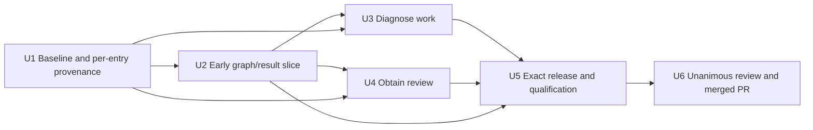

# feat: Add portable diagnosis and host review workflow stages

## Outcome

Extend the exact, authenticated `agent-skills` workflow module with the smallest
portable tranche that lets the broader managed delivery system:

- route unknown-cause work through evidence-first diagnosis;
- describe delivery as a machine-readable graph of canonical workflow stages;
- accept normalized results from harness-realized stages without becoming an
  execution runtime; and
- acquire caller-selected review-lens results for the unchanged `review-work`
  convergence reducer.

The tranche must preserve the managed-system ownership split:

- `agent-skills` owns portable workflow semantics, canonical stage declarations,
  closed result shapes, exact profile releases, and deterministic qualification;
- the active host and `agent-delivery-harness` own realization, durable runs and
  attempts, scheduling, cancellation, fencing, retries, workspaces, permissions,
  policy compilation, candidate admission, checkpoints, and finish-line authority;
- harness/adopter-owned capability bindings own publication and feedback actions;
  `agent-skills` emits only typed stage handoffs and consumes only normalized
  stage results; and
- the adopting repository owns reviewer selection, branch and PR conventions,
  disclosure policy, mutation authority, merge policy, deployment, and domain
  rules.

The implementation finish line remains one reviewed PR merged into the
`agent-skills` default branch with fresh, exact core, Linear, and provider
qualification evidence for the final candidate.

## Current-State Evidence

- `deliver-work` normalizes `diagnose` but has no released `diagnose-work`
  workflow behind that route.
- `review-work` is deliberately a pure reducer over caller-supplied lens results;
  it does not select reviewers, invoke hosts, or obtain results.
- `agent_skills/capabilities.py` declares only the neutral tracker boundary.
  There is no machine-readable workflow graph or portable stage-result contract.
- The delivery-provider rail owns request/event causality and installed-provider
  evidence, but explicitly owns no agent invocation, repository policy, or
  durable managed state.
- Releases are exact allowlisted archives: catalog membership, profile
  `expectedFiles`, release payload rules, provenance output digests, schemas,
  validation inventory, and qualification records must change together.
- `linear` is a supported exact profile that includes core. Changing core changes
  the exact Linear candidate and requires fresh Linear evidence; support is not
  withdrawn to avoid qualification work.
- `AGENTS.md` records Athena revision
  `342850073464a2c9b6198d32d11475f5fa5cbe53` as an approved source baseline, but
  the relevant newer skill bodies are absent there. New entries need their own
  immutable origin rather than silently advancing one corpus-wide baseline.

## Execution Posture

Use **characterization-first** throughout. Freeze current routing, reducer purity,
provider ownership, exact release behavior, installation, rollback, host
discovery, and Linear behavior before extending them. Each new contract begins
with failing positive and negative scenarios. No existing boundary may be
weakened to make a new scenario pass.

Implementation proceeds through an early vertical slice before broad registry
and release integration: the complete canonical graph must validate, while its
`intake -> diagnose -> plan` path passes through an independent harness-shaped
fake consumer and returns a bound result before the graph and workflows are
added to the release surface.

## Plan Review Status

**Round 1: incorporated.** The plan now:

- removes the neutral publication operation contract, GitHub adapter/profile,
  protected GitHub qualification, and their former implementation units;
- narrows the portable execution boundary to `workflow-stage-result/1` and a
  machine-readable workflow graph, leaving all runtime and durable attempt state
  to the harness;
- makes diagnosis an intake/planning/remediation subflow that returns evidence to
  the same managed checkpoint and never grants fix authority;
- makes review acquisition caller-lens-driven, exactly candidate-bound, and
  honest about independence unless the harness supplies attestation;
- selects immutable provenance revisions per entry plus an explicit
  `independent-origin` source kind instead of advancing one global baseline;
- retains Linear support and requires fresh exact core, Linear, and provider
  qualifications for the changed closure;
- assigns qualification drivers, tests, and checked records explicitly;
- reduces execution to six units, with an early vertical slice and grouped
  completion requirements.

**Round 2: findings incorporated.** The revision now makes `implement` the
canonical stage realized by `execute-work`, separates successful handoff output
kinds from non-success statuses, defines requiredness and overlay omission rules,
makes candidate binding conditional, fixes the exact binding tuple, assigns the
protected Linear collector boundary, and pins a real independent JSON Schema
engine for the fake consumer. Later review passes made the stage matrix
authoritative, separated produced-candidate binding from checkpoint binding,
kept compounding decision-only, and defined exact review-envelope projection.
Implementation requires a unanimous six-lens review record for this file's exact
SHA-256 in the adjacent `2026-08-29-portable-autonomous-delivery-tranche.review.json`;
this historical summary does not itself grant approval.

## Scope

### In scope

- `workflow-stage-result/1`: a closed normalized result produced after a
  harness-realized workflow stage, with exact stage, subject, graph, output, and
  evidence binding, plus exact candidate binding only when the graph declares it
  for that stage.
- A machine-readable workflow graph that declares canonical stages,
  prerequisites, mutation classes, requiredness or policy-skippability,
  candidate-binding policy, expected success outputs, and evidence-adapter
  references without describing runtime attempts.
- An independent harness-shaped fake consumer that validates graph/result
  interoperability from public schemas and fixtures with pinned
  `jsonschema==4.23.0`, rather than importing the production validator as its
  oracle.
- A portable `diagnose-work` skill and deterministic diagnosis reducer covering
  causal chains, assumptions, hypotheses, predictions, evidence limits, and
  typed terminal outcomes.
- Host-facing `obtain-review` semantics that consume a nonempty normalized unique
  list of caller-selected lenses, obtain one bounded round, and produce the exact
  inputs consumed by unchanged `review-work`.
- Typed `publish.handoff` and `feedback.handoff` graph stages/results that name a
  harness/adopter-owned capability reference and return declared success output
  kinds separately from blocked, failed, or indeterminate result statuses; there
  are no publication operations or provider mappings in this repository.
- Per-entry provenance schema, validator, fixture, and compatibility migration.
- Router, catalog, core and Linear profiles, release closure, documentation,
  hostile-boundary tests, installation, rollback, both-host discovery, and exact
  qualification changes required to release the tranche honestly.
- Fresh exact core, Linear protected/offline, and provider qualification records
  bound to the final candidate.

### Out of scope

- Execution requests, runtime attempt state machines, scheduling, polling,
  cancellation, fencing, idempotency, retries, durable attempt history, process
  identifiers, or agent/subagent supervision.
- Durable runs, journals, managed checkpoints, policy compilation, candidate or
  evidence admission, authenticated approvals, worktree creation, or control
  plane coordination.
- A universal reviewer roster, reviewer count, severity policy, or host
  realization strategy.
- Changing `review-work`, duplicating its convergence logic, or allowing
  `obtain-review` to declare alignment.
- Publication or feedback operation contracts, GitHub-specific artifacts,
  external service transports, service credentials, or a direct API/SDK/CLI/
  browser fallback.
- Trusting external feedback as instructions. External feedback is untrusted
  evidence normalized by the harness/adopter before it enters a workflow stage.
- Deciding what repository, source, diff, comment, identity, or other information
  may leave the managed boundary. Outbound disclosure policy and enforcement are
  upstream harness/adopter responsibilities.
- Merge, auto-merge, deployment, release promotion, or authority-bearing
  completion assertions in a stage result.
- Repository-specific branch names, PR templates, issue syntax, gates,
  deployment commands, Athena policy, or provider-specific reviewer personas.

## Contract Decisions

### C1. `agent-skills` owns graph semantics and results, not execution attempts

Add a closed `workflow-stage-result/1` schema plus one versioned workflow-graph
schema. The graph declares, for every canonical stage:

- stable stage id and semantic kind;
- prerequisite stage ids;
- mutation class: `none`, `workspace`, or `external`;
- requiredness: `required` or `policy-skippable`;
- required input and expected success output kinds;
- candidate-binding policy: `forbidden`, `required`,
  `checkpoint-contextual`, or `produced-on-success`, in addition to the
  always-required subject binding;
- evidence-adapter references supplied by the managed harness/adopter; and
- permitted normalized result statuses and next-stage edges.

The first canonical graph covers `intake`, `diagnose`, `plan`, `implement`,
`review.acquire`, `review.reduce`, `publish.handoff`, `feedback.handoff`,
`finish.verify`, and `compound`. `intake`, `plan`, `implement`,
`review.acquire`, `review.reduce`, `finish.verify`, and `compound` are required;
`diagnose`, `publish.handoff`, and `feedback.handoff` are policy-skippable in the
portable graph. An adopting overlay may strengthen a policy-skippable stage to
required. It may mark a stage omitted only when the canonical declaration says
`policy-skippable` **and** the overlay has not strengthened that stage's effective
requiredness to `required`. The overlay must retain the stage id with
`disposition: omitted`, an opaque policy reference, and an omission reason. It
may not delete the canonical declaration, omit an effectively required stage,
claim an omitted stage succeeded, redefine stage meaning, weaken prerequisites,
or invent an edge not permitted by the canonical graph.

The following matrix is the authoritative first graph. U2 implements it without
adding stage semantics. `Evidence adapter` means a named harness/adopter adapter
reference is required in the stage declaration; ordinary evidence references in
results remain governed by the result schema. A conditional prerequisite is
satisfied only when that stage was invoked; an omitted policy-skippable stage
satisfies only edges that explicitly allow omission. Back edges retain the same
checkpoint, subject, prior prerequisite evidence, and current candidate rather
than beginning a new run.

| Stage | Semantic kind | Prerequisites | Mutation | Requiredness | Candidate binding | Required inputs | Success output kinds | Permitted statuses | Evidence adapter | Permitted next stages |
| --- | --- | --- | --- | --- | --- | --- | --- | --- | --- | --- |
| `intake` | scope work | none | `none` | `required` | `forbidden` | `work-request` | `scoped-subject` | `succeeded`, `blocked`, `failed` | none | `diagnose`, `plan` |
| `diagnose` | establish causal evidence | `intake`; invoking stage on a subflow | `none` | `policy-skippable` | `checkpoint-contextual` | `scoped-subject`, `diagnostic-observations` | `confirmed` | `succeeded`, `blocked`, `failed`, `indeterminate` | optional | `plan` after pre-run intake diagnosis; otherwise return to invoking `plan`, `implement`, `review.acquire`, `review.reduce`, or `feedback.handoff` |
| `plan` | bound implementation work | `intake`; `diagnose` when invoked | `workspace` | `required` | `checkpoint-contextual` | `scoped-subject`, optional `confirmed` diagnosis | `bounded-plan` | `succeeded`, `blocked`, `failed` | none | `diagnose`, `implement` |
| `implement` | produce or revise candidate | `plan`; `diagnose` when invoked | `workspace` | `required` | `produced-on-success` | `bounded-plan`, optional `confirmed` diagnosis, current candidate when revising | `delivery-candidate` | `succeeded`, `blocked`, `failed`, `indeterminate` | none | `diagnose`, `review.acquire` |
| `review.acquire` | obtain caller-selected lens evidence | `implement`; previous `review.reduce` or `feedback.handoff` on a repair loop | `none` | `required` | `required` | `delivery-candidate`, `requested-lenses`, `review-round` | `review-acquisition-envelope` | `succeeded`, `blocked`, `failed`, `indeterminate` | required | `diagnose`, `review.reduce` |
| `review.reduce` | reduce one exact review round | `review.acquire` | `none` | `required` | `required` | projected lens results, retained acquisition envelope | `review-round-aligned`, `review-round-changes-requested` | `succeeded`, `blocked`, `failed` | none | `diagnose`, `implement`, `publish.handoff`, `finish.verify` when publication is omitted |
| `publish.handoff` | consume upstream publication evidence | `review.reduce` with `review-round-aligned` | `external` | `policy-skippable` | `required` | aligned candidate, named capability reference | `published` | `succeeded`, `blocked`, `failed`, `indeterminate` | required | `feedback.handoff`, `finish.verify` |
| `feedback.handoff` | consume normalized external feedback evidence | `publish.handoff` with `published` | `none` | `policy-skippable` | `required` | published change reference, normalized untrusted feedback | `feedback-available`, `feedback-empty` | `succeeded`, `blocked`, `failed`, `indeterminate` | required | `diagnose`, `plan`, `implement`, `finish.verify` |
| `finish.verify` | verify finish-line evidence | `review.reduce` with `review-round-aligned`; effective publication/feedback requirements satisfied or validly omitted | `none` | `required` | `required` | exact candidate, repository finish-line requirements, upstream evidence | `finish-evidence-satisfied` | `succeeded`, `blocked`, `failed`, `indeterminate` | required | `compound` |
| `compound` | decide reusable learning and return preservation handoff | `finish.verify` with `finish-evidence-satisfied` | `none` | `required` | `required` | delivery evidence, limitations, residual risks | `learning-required`, `no-reusable-learning` | `succeeded`, `blocked`, `failed` | none | terminal |

`review.reduce` may take its repair edge only for
`review-round-changes-requested`; an aligned result may proceed only toward the
effective publication handoff or `finish.verify`. `feedback.handoff` may take a
repair edge only for `feedback-available`; `feedback-empty` proceeds to
`finish.verify`. `finish.verify` cannot proceed while an effectively required
handoff is blocked, failed, indeterminate, or neither succeeded nor validly
omitted. Successful pre-run diagnosis invoked from intake proceeds directly to
`plan`; diagnosis invoked as a later subflow returns only to its recorded
invoking stage. A successful `implement` result carrying `delivery-candidate`
uses the `produced-on-success` policy and must bind the new exact candidate
independently captured by the harness, not the prior checkpoint candidate.
Non-success implementation results bind the prior checkpoint candidate when
revising and omit `candidateRef` when an initial attempt produced none.
`compound` only decides and returns a repository-owned
preservation handoff; it never claims that learning was written. Separately
authorized knowledge capture and any resulting candidate revalidation remain
outside this tranche. These predicates are graph data and validator scenarios,
not prose-only orchestration hints.

The canonical implementation stage id is `implement`. `execute-work` is the
portable workflow skill used by the active host to realize that stage; it is not
a second canonical stage, graph alias, or durable execution primitive.

Every exact binding tuple contains `release`, shaped exactly like the public
`VerifiedRelease` projection with `releaseId`, `profile`, `archiveSha256`, and
`metadataSha256`; `graphSha256`; and `subjectRef`, shaped as
`{schemaVersion: "workflow-subject-ref/1", opaque: "..."}`. A
stage whose graph declaration requires candidate binding must also carry
`candidateRef`, shaped as `{schemaVersion:
"workflow-candidate-ref/1", opaque: "..."}`. The harness/adopter maps its durable
identity into these neutral opaque references. `agent-skills` checks
the versions, nonempty opacity, and exact equality, but never parses or assigns
meaning to the opaque values. A `forbidden` stage must omit `candidateRef`; a
`required` stage must include it. A `checkpoint-contextual` stage must include and
exactly match the harness checkpoint's current candidate when one exists, and
must omit `candidateRef` before any candidate exists. `diagnose` is
checkpoint-contextual so both pre-candidate intake diagnosis and remediation of
an existing failing candidate are represented honestly. `produced-on-success`
is separate from checkpoint-contextual binding: success must exactly match the
harness-supplied produced-candidate reference in admission context, whereas
non-success uses the prior checkpoint candidate or omits the reference if none
exists. The harness must capture the produced candidate independently before
admission; the result cannot nominate its own trusted comparison value or advance
the checkpoint to make itself valid. Placeholders and speculative candidates
always reject.

A stage result contains graph/release identity, canonical stage id, exact subject
reference, exact candidate reference only when required, status (`succeeded`,
`blocked`, `failed`, or `indeterminate`), normalized output, evidence references,
limitations, and one actionable next step for non-success. Only `succeeded` may
carry one of the stage's declared success output kinds. `blocked`, `failed`, and
`indeterminate` are statuses, never output kinds, and must not carry a success
output. A stage result cannot create or advance a run, checkpoint, invocation,
attempt, approval, or finish line.

The contract contains no execution-request document, cancellation transition,
fence, idempotency key, scheduling field, mutable attempt state, host transcript,
credential, permission grant, or retry algorithm. Those are harness-owned.
Unknown fields or versions, missing prerequisite evidence, wrong graph/stage/
subject binding, missing or forbidden candidate binding, wrong contextual or
required candidate binding, forbidden authority claims, or success without the
stage's expected outputs fail closed.

### C2. Diagnosis is a route and subflow, never a new authority boundary

For unknown-cause work, `deliver-work` selects `diagnose-work` during pre-run
intake/scoping before a plan or implementation authorization is assumed.
Diagnosis may also run as a planning or remediation subflow when a later stage
uncovers an unexplained failure. In every case it returns normalized evidence to
the same harness-managed checkpoint that invoked it; it never creates another
checkpoint, resets the run, or advances durable state.

Diagnosis has one success output kind, `confirmed`, carried only with
`status: succeeded`. A confirmed result requires an evidence-backed
trigger-to-symptom causal chain. An uncertain link needs a stated prediction and
observed result. An inconclusive diagnosis uses `status: indeterminate`; a
diagnosis blocked on a missing required condition uses `status: blocked`.
Neither non-success state carries a success output, and both carry one actionable
next step. A diagnosis result may recommend tests or a remediation handoff, but
it never authorizes or performs a fix. A separately authorized canonical
`implement` stage, realized by `execute-work`, consumes the retained evidence.

### C3. Review acquisition produces exact reducer inputs

`obtain-review` accepts:

- a nonempty list of normalized, unique, caller-selected lens identifiers;
- exact release, graph, subject, candidate, and round binding; and
- bounded lens context and expected result shape.

It returns a closed review-acquisition envelope preserving the caller's order and
exact binding. The envelope contains one typed entry per requested lens with an
acquisition state of `obtained`, `failed`, `indeterminate`, or `missing`, the
normalized obtained result when present, and independence metadata. A
deterministic projection feeds the existing `review-work` reducer without
changing that reducer's input or convergence semantics: obtained entries project
to the existing `aligned` or `changes-requested` lens results; failed and
indeterminate entries project to existing `failed` lens results with stable
failure codes; missing entries are omitted so the reducer's existing missing-lens
blocker fires. The complete acquisition envelope remains retained evidence
outside the projected reducer inputs.

`obtain-review` does not select lenses, mutate the candidate, remediate findings,
or emit round-level alignment/convergence. It may preserve and project an
individual lens disposition of `aligned`; only `review-work` may reduce the
complete round to convergence. A lens result is marked `independence: unverified`
by default.
Only a harness-owned host attestation that binds the exact lens result, release,
graph, subject, candidate, round, and distinct realization may mark independence
as attested. Different
labels, prompts, or logical personas are not proof of independent realization.

Any candidate mutation requires a new round bound to the new exact candidate.
Old results remain history but cannot satisfy the new round. The fake consumer
must prove both stale-candidate rejection and a successful new round after repair.

### C4. Publication and feedback are authority-negative stage handoffs

`publish.handoff` and `feedback.handoff` are canonical graph stages whose
expected output is a typed result from a named harness/adopter-owned evidence or
capability adapter. The handoff may state required outcome kinds such as
`published` or `feedback-available` for `succeeded` results. `blocked`, `failed`,
and `indeterminate` remain result statuses and can never masquerade as successful
output kinds. The handoffs do not define create, update, comment, resolution,
retry, or provider operations.

The stage declaration and result refer to capability authority; they do not
provide it. Required publication that is unavailable remains `status: blocked`
with no `published` output. A portable policy-skippable handoff may be omitted by
an overlay only under C1's explicit omission rules; omission is neither success
nor external action. External feedback remains marked untrusted after upstream
normalization and policy checks succeed; those checks make it eligible for
evaluation and possible separately authorized remediation, never trusted as
instructions.
Any outbound disclosure decision happens before host invocation under upstream
policy and is not inferred from a skill, graph edge, or stage result.

### C5. Provenance is immutable per catalog entry

Do not advance a single global Athena source baseline. Migrate provenance so
each catalog entry/output identifies its immutable origin independently:

- `repository-source`: immutable repository revision plus path and source hash;
- `independent-origin`: locally authored portable work with an explicit rationale,
  owner approval, and output hash; or
- the existing source-only classification where applicable.

Each new `diagnose-work` or `obtain-review` entry chooses one origin kind and is
validated independently. Derived Athena material cites the exact immutable
revision that contains it. Independently authored material cannot claim Athena
derivation. The migration changes the provenance schema, runtime validator,
positive and hostile fixtures, compatibility documentation, existing entries,
and release tests atomically. Existing immutable release artifacts remain
verifiable under their recorded schema/version.

### C6. Exact release closure and supported Linear profile remain intact

New portable files enter `core`; `linear` remains supported as exact core plus
the existing Linear adapter. There is no new provider profile. Catalog,
`SUPPORTED_PROFILES`, profile `expectedFiles`, schemas, validation inventory,
release payload allowlists, provenance output digests, and checked qualification
records change together.

Because core changes, final qualification must produce fresh candidate-bound:

- core qualification through `scripts/qualify-core.py` and its focused tests;
- Linear protected attestation and offline qualification through
  `scripts/qualify-linear.py` and its focused tests; and
- provider qualification through `scripts/qualify-provider.py` and its focused
  tests, including the installed exact core identity used by that rail.

Old releases remain independently verifiable and rollback stays
source-independent. New support claims are never inherited from an older record.

The protected host-native Linear qualification task, operated by an authorized
`agent-skills` release maintainer, owns live collection. It alone invokes the
configured Linear MCP boundary and emits the canonical redacted attestation;
`scripts/qualify-linear.py` owns offline validation and record production, not
collection or external provenance. Before live operations, the collector receives
and freezes both exact core and Linear `VerifiedRelease` four-field identities,
the released `graphSha256`, and version-tagged opaque qualification subject and
candidate references. The attestation echoes that binding and its external
receipt reference. The offline driver rejects a mismatch between any attested
field, either verified archive, the checked core record, or the graph bytes.

Protected collection is a release gate, not an optional sensor. If the authorized
collector, configured host-native Linear MCP boundary, exact candidate artifacts,
or live receipt is unavailable, the Linear attestation cannot be refreshed and U5
is blocked. An old, unbound, hand-authored, or locally simulated attestation may
test negative paths but cannot support the changed exact Linear profile.

## Implementation Units

### U1. Characterize the baseline and migrate per-entry provenance

**Goal:** Freeze current behavior and establish honest immutable origins for the
new entries before any derived skill is released.

**Posture:** `characterization-first`, then `test-first` for the migration.

**Dependencies:** None.

**Ownership:**

- `schemas/provenance.schema.json`
- `provenance.lock.json`
- `agent_skills/validate.py` provenance validation only
- provenance fixtures in `tests/fixtures/`
- focused provenance/registry/release compatibility tests
- `docs/classification.md` provenance sections
- `docs/compatibility.md` provenance migration sections

**Approach:** Characterize router handoff, reducer purity, provider ownership,
current profile closure, installation, rollback, host discovery, and exact
qualification behavior. Inventory the precise source material for each proposed
entry. Add per-entry `repository-source` and `independent-origin` validation,
migrate existing live metadata without rewriting retained release artifacts, and
record maintainer approval for each new origin.

**Required scenarios:** Old release still verifies; mutable revisions reject;
missing path/hash/rationale/owner fields reject by source kind; two entries may
legitimately point to different immutable revisions; one new independently
authored entry does not advance another entry's source; output hash mismatch
rejects.

### U2. Prove an early graph/result vertical slice

**Goal:** Prove that a public workflow graph and `workflow-stage-result/1` can be
consumed independently before broad release integration.

**Posture:** `test-first`.

**Dependencies:** U1 schema direction and approved origins.

**Ownership:**

- `schemas/workflow-graph.schema.json`
- `schemas/workflow-stage-result.schema.json`
- `docs/workflow-graph-v1.md`
- `agent_skills/workflow_graph.py`
- graph/result fixtures under `tests/fixtures/`
- `tests/test_workflow_graph_contract.py`
- independent fake consumer under `tests/consumers/`
- `pyproject.toml` test extra and `.github/workflows/ci.yml` dependency setup

**Approach:** Encode the complete C1 canonical graph, including all ten stage
declarations, their requiredness, candidate-binding policy, permitted omission,
prerequisites, outputs, and edges. The first executable interoperability slice
exercises only `intake -> diagnose -> plan`; U3 and U4 add workflow behavior,
while U5 only integrates and releases the already complete graph and schema.

Build a harness-shaped fake consumer that reads only published schema/fixture
artifacts, maintains its own checkpoint/candidate test state, and independently
determines whether a result can be admitted. Add a `test` optional dependency in
`pyproject.toml` pinned to `jsonschema==4.23.0`, and make every CI matrix job run
`python -m pip install -e ".[test]"` before validation. The fake consumer uses
that independent Draft 2020-12 JSON Schema engine for graph/result validation; it
must not import the production validator or copy its schema-validation decision
function. Test orchestration may submit the same planted vectors separately to
the production validator and fake consumer to prove conformance without making
one the other's oracle.

The repository currently declares no runtime or test dependencies and CI runs
the Python files directly without an install step. A single pinned optional test
extra plus one cross-platform CI install step is therefore the least disruptive
setup: production remains standard-library-only, while the independence claim is
backed by a real third-party schema engine rather than copied validation logic.

**Required scenarios:** Valid diagnosis result returns to the fake consumer's
same checkpoint; unknown stage/version/field rejects; unmet prerequisite rejects;
a contextual stage forbids a candidate before one exists, requires the exact
checkpoint candidate after one exists, and rejects a mismatch; initial
implementation success binds independently captured B, initial failure omits a
candidate, revision A-to-B success binds B, and revision failure retains A, with
wrong/missing produced-candidate references rejected; every canonical
stage declares requiredness; an effectively required stage cannot be omitted;
only a declared policy-skippable stage can be marked omitted with policy
reference and reason when the overlay has not strengthened it to required;
status/output-kind confusion rejects;
stage result attempting to assert approval/checkpoint advancement rejects; no
runtime attempt or scheduling fields exist; planted schema and validator drift is
caught by the independent consumer.

### U3. Add portable evidence-first diagnosis

**Goal:** Resolve unknown-cause intake and later diagnostic subflows without
granting implementation authority.

**Posture:** `test-first`.

**Dependencies:** U1, U2.

**Ownership:**

- `skills/diagnose-work/SKILL.md`
- `agent_skills/diagnosis.py`
- `tests/scenarios/core/diagnose.json`
- `tests/test_diagnosis.py`

**Approach:** Implement C2 as a concise portable workflow and deterministic
reducer. Route pre-run unknown-cause intake to it; expose the same result shape
for planning and remediation subflows. Keep production safeguards, issue tools,
observability vendors, browser tools, repository commands, and fix authorization
outside the portable layer.

**Required scenarios:** Complete causal chain confirms; uncertain link requires a
satisfied prediction; contradicted prediction cannot confirm; unavailable
reproduction remains inconclusive; missing required condition blocks; ruled-out
hypotheses are retained; result returns to the same managed checkpoint; confirmed
diagnosis neither mutates nor claims fix authority; authorized implementation can
consume the evidence later through canonical `implement` realized by
`execute-work`.

### U4. Add exact, caller-selected review acquisition

**Goal:** Let an active host return a complete caller-selected lens round while
preserving `review-work` as the sole convergence reducer.

**Posture:** `test-first`.

**Dependencies:** U1, U2.

**Ownership:**

- `skills/obtain-review/SKILL.md`
- `agent_skills/review_orchestration.py`
- `tests/scenarios/core/obtain-review.json`
- `tests/test_review_orchestration.py`
- review scenarios in the independent fake consumer

**Approach:** Implement C3. Normalize and reject empty, duplicate, or invalid
lens sets before host realization. Bind every result to exact release, graph,
subject, candidate, and round identities. Preserve the complete typed acquisition
envelope as evidence, then deterministically project obtained, failed,
indeterminate, and missing entries into unchanged `review-work` inputs as C3
defines. Keep independence unverified unless a valid harness-owned
distinct-realization attestation is present.

**Required scenarios:** Empty list rejects; normalized duplicates reject; caller
order is preserved; obtained results project to aligned or changes-requested;
failed and indeterminate entries project to stable failed codes; a missing entry
is omitted from reducer input so its existing blocker fires while remaining in
the retained envelope; release, graph, subject, candidate, or round mismatch
rejects; stale candidate A results cannot satisfy candidate B;
candidate B accepts a completely new round; sequential host realization is
semantically valid; unsupported independence claims reject; acquisition may
preserve a lens-level `aligned` disposition but cannot emit round-level
alignment/convergence or mutate/remediate the candidate.

### U5. Integrate the release and produce exact qualification evidence

**Goal:** Release the graph, diagnosis, review acquisition, and typed external
handoff stages as one exact core change while keeping Linear and provider rails
supported and independently proven.

**Posture:** `characterization-first` for shared registry/release surfaces;
`sensor-only` for final qualification records.

**Dependencies:** U1-U4.

**Ownership:**

- `agent_skills/router.py`
- `agent_skills/workflows.py` only for normalized handoffs/imports
- `agent_skills/release.py`
- `agent_skills/validate.py` non-provenance integration
- `agent_skills/__init__.py`
- `catalog.json`
- `profiles/core.json`
- `profiles/linear.json`
- `schemas/catalog.schema.json`
- `schemas/profile.schema.json`
- `validation-inventory.json`
- `README.md`
- `docs/host-adapters.md`
- registry/router/catalog/release/lifecycle/host/core-boundary tests
- `scripts/qualify-core.py` and `tests/test_qualification.py`
- `scripts/qualify-linear.py`, `tests/test_linear_qualification.py`, and the
  protected collector protocol in `README.md`, fresh exact
  `qualifications/linear-*.attestation.json`, and
  `qualifications/linear-*.json` records
- `scripts/qualify-provider.py`, `tests/test_provider_qualification.py`, and the
  fresh exact `qualifications/provider-*.json` record
- the fresh exact `qualifications/core-*.json` record

**Approach:** Route `diagnose` to `diagnose-work`; integrate and release U2's
already complete canonical graph and stage-result contract, both new skills,
runtime reducers, fixtures, and docs in core. U5 does not define or expand graph
semantics. It exposes U2's `publish.handoff` and `feedback.handoff` declarations
only as stages bound to upstream adapter references. Update every exact allowlist
and digest. Preserve Linear as exact core plus its adapter.

Build and verify the final core and Linear candidate archives first. The
authorized release maintainer then runs the protected host-native Linear
collector against those frozen candidates and U2's exact graph, retaining only a
canonical redacted attestation and opaque receipt. Run the offline driver only
after collection; it must prove that the attestation binds both archives' four
`VerifiedRelease` fields, `graphSha256`, and the version-tagged opaque subject and
candidate references. If protected collection is unavailable or the binding is
not exact, stop U5 as blocked rather than copying forward evidence. Finally run
each qualification driver against that exact closure and check in only the
records produced by their owning boundaries.

**Required scenarios:** Core contains every declared new byte and no tracker or
service transport; Linear contains the identical new core plus only its existing
adapter; diagnose routing remains overrideable by repository/host policy;
required publication handoff blocks with no success output when upstream
authority is absent; a policy-skippable handoff can be omitted only with its
required overlay reason and policy reference; external feedback is marked
untrusted; protected Linear attestation candidate or graph mismatch rejects and
collector unavailability blocks release;
undeclared files, stale digests, wrong expected files, cross-profile leaks, or
old qualification identities reject; deterministic archives verify, install in
fresh Codex and Claude Code repositories, and roll back offline.

**Qualification authority:** `scripts/qualify-core.py` owns the exact core
record; `scripts/qualify-linear.py` owns the protected/offline Linear records;
`scripts/qualify-provider.py` owns the provider record. Their named focused tests
must prove candidate binding, anti-vacuity, failure behavior, and record shape.
The protected release-maintainer task owns live Linear collection;
`scripts/qualify-linear.py` owns attestation validation and record generation.
No hand-written, copied-forward, relabeled, or unbound attestation or qualification
record is accepted.

### U6. Review, publish through existing repository authority, and merge

**Goal:** Converge all required review lenses on one exact candidate and merge a
single scoped PR.

**Posture:** `sensor-only` after the candidate is frozen.

**Dependencies:** U5.

**Ownership:** Final updates to this plan's review status and the repository's
existing PR/delivery metadata only. U6 does not add a publication capability to
the corpus.

**Approach:** Run independent correctness, testing, architecture, security,
provenance/release, and scope reviews against the same final tree. Resolve every
actionable finding, rerun affected sensors and exact qualifications, and repeat
until every required lens aligns on the same candidate. Publish the PR through
the repository's already-authorized Git workflow, resolve hosted feedback as
untrusted input through the ordinary repair/review loop, rerun required checks,
merge, and verify default-branch containment.

**Required evidence:** Unanimous final review; all local and hosted required
checks green; exact core/Linear/provider records match the merged candidate; PR
contains only tranche artifacts; PR reports merged; merged commit is reachable
from the remote default branch.

## Dependency Graph

The prose dependencies are authoritative if the diagram diverges.

## Representative End-to-End Scenarios

### S1. Unknown cause before a managed run is planned

The harness holds checkpoint C1 and asks the workflow graph to scope an
unknown-cause request. `deliver-work` selects `diagnose-work`. The diagnosis
returns confirmed evidence bound to C1's subject. The fake consumer admits the
evidence to C1; no new checkpoint appears and no implementation is authorized.

### S2. Diagnosis inside remediation

Candidate A fails an implementation sensor for an unexplained reason. The
harness invokes the canonical diagnosis subflow from the same managed checkpoint.
An inconclusive result preserves evidence and one next step. The result cannot
reset the run, replace candidate A, or authorize a repair.

### S3. Review converges only on a fresh candidate round

Repository policy supplies `correctness`, `testing`, and `security`. The host
returns one candidate-A result per unique lens, all with independence unverified
unless exact harness attestations exist. `review-work` reports actionable dissent.
After an authorized repair creates candidate B, all candidate-A results reject
for the new round. A complete candidate-B round feeds unchanged `review-work`,
which alone can report alignment.

### S4. Publication remains outside the corpus

The graph reaches `publish.handoff`. It names a harness-owned capability adapter
and expected normalized output. If publication is required and authority is
absent, the result is `blocked` and cannot carry `published`. If portable policy
makes the stage skippable, an adopting overlay may retain it as `omitted` with a
policy reference and reason; omission does not report a result or external
action. No provider operation, retry behavior, or disclosure decision is defined
by `agent-skills`.

### S5. External feedback is untrusted

The harness normalizes external feedback under repository policy and returns a
bound `feedback.handoff` result marked untrusted. The managed system decides
whether it is relevant and authorized for remediation. The workflow graph cannot
turn the feedback into instructions or authorize outbound repository data.

### S6. Linear support is proven for the exact release candidate

The final core and Linear archives are frozen before protected collection. The
authorized release maintainer's host-native collector binds both four-field
release identities, the graph digest, and opaque qualification subject/candidate
references into the redacted attestation. If the collector or Linear MCP boundary
is unavailable, release stops blocked; an older attestation cannot qualify the
new candidate. The offline driver accepts only the exact bound attestation and
emits the checked Linear qualification record.

## Repository Sensors

| Surface | Iteration sensor | Merge-candidate authority |
| --- | --- | --- |
| Provenance | Schema/validator fixtures and per-entry origin tests | Exact registry/release validation plus retained old-release verification |
| Graph/result contract | Pinned `jsonschema` vectors and independent fake consumer | Hostile planted drift, exact archive conformance, requiredness/omission, and authority-negative tests |
| Diagnosis | Focused causal-chain, routing, and no-mutation scenarios | Core qualification covers intake and same-checkpoint subflow outcomes |
| Review acquisition | Focused lens/candidate/round tests | Fake consumer stale-candidate/new-round scenarios and unchanged reducer regression |
| Release closure | Registry, catalog, profile, lifecycle, and host tests | Deterministic build/verify/install/rollback for core and Linear |
| Qualification | Focused driver, collector-binding, and record-shape tests | Fresh exact core, protected candidate-bound Linear attestation/offline record, and provider record |
| Delivery | Local full suite and independent multi-lens review | Hosted checks, merged PR state, and default-branch containment |

Passing a focused workflow test cannot prove release closure. A result accepted
by the production validator cannot prove independent consumer interoperability.
A stage result cannot prove external authority or managed completion. Each claim
must use evidence from its owning boundary.

## Risks and Mitigations

| Risk | Mitigation |
| --- | --- |
| Portable contract becomes a shadow orchestrator | No execution request or attempt lifecycle exists; graph declares semantics and result shape only |
| Diagnosis creates a second run boundary | Same-checkpoint fake-consumer scenarios and authority-negative schema assertions |
| Diagnosis quietly authorizes a fix | No-mutation sensor and explicit authorization of canonical `implement`, realized by `execute-work` |
| Overlay silently bypasses required work | Every canonical stage declares requiredness; overlays retain omitted stages and may omit only policy-skippable entries with policy reference and reason |
| Non-success is mistaken for handoff success | Success output kinds exist only on `succeeded`; blocked, failed, and indeterminate results cannot carry them |
| Reviewer labels are mistaken for independence | Default `unverified`; only exact harness distinct-realization attestation can upgrade the claim |
| Stale review passes after repair | Exact candidate/round binding and mandatory complete new-round scenario |
| External feedback becomes prompt injection | Feedback remains untrusted and upstream policy decides whether it enters remediation |
| Workflow leaks repository data externally | Disclosure policy and invocation authority stay upstream; graph contains references, not transport behavior |
| New entries are falsely attributed to one Athena baseline | Per-entry immutable origins and explicit `independent-origin` kind |
| Linear support silently regresses after core changes | Fresh exact Linear protected/offline qualification is mandatory, with no withdrawal path |
| Linear evidence is copied forward when live collection is unavailable | Protected collector owns live evidence, exact candidate/graph binding is mandatory, and unavailability blocks U5 |
| Qualification record proves only itself | Independent consumer, planted mutations, candidate binding, anti-vacuity tests, and driver-owned records |
| Tranche expands into Athena policy | Portable contracts exclude repository commands, personas, merge gates, production safeguards, and domain rules |

## Observable Finish Line

Completion is proven only when every item below is true for the same final
candidate and its exact artifacts.

### Product behavior

- `diagnose` routes to released `diagnose-work`; confirmed, inconclusive,
  blocked, same-checkpoint, and unauthorized-fix scenarios pass.
- The canonical graph and `workflow-stage-result/1` define stages,
  prerequisites, mutation classes, requiredness, overlay omission rules, expected
  success outputs, evidence-adapter references, and the conditional exact binding
  tuple without runtime-attempt semantics.
- `implement` is the sole canonical implementation stage and `execute-work` is
  documented and tested only as its host realization.
- The independent fake consumer admits valid results and rejects schema drift,
  authority claims, wrong prerequisites, invalid omissions, status/output-kind
  confusion, and forbidden, missing, or mismatched candidate references using the
  pinned independent JSON Schema engine.
- `obtain-review` requires nonempty normalized unique caller lenses, produces
  unchanged `review-work` inputs, defaults independence to unverified, and
  rejects stale candidate results until a fresh round exists.
- Publication and feedback appear only as authority-negative typed handoff/result
  stages; external feedback is untrusted and disclosure authority is upstream.

### Exact release and qualification

- Catalog, core and Linear profiles, provenance, schemas, validation inventory,
  expected files, runtime/docs/tests, and release allowlists agree exactly.
- Per-entry immutable provenance is validated; retained old releases still
  verify; no global baseline was silently advanced.
- Final core and Linear archives build deterministically, verify independently,
  install into fresh repositories, expose the same generation to Codex and
  Claude Code, and roll back offline.
- `scripts/qualify-core.py`, `scripts/qualify-linear.py`, and
  `scripts/qualify-provider.py` produce fresh exact candidate-bound records, and
  their focused tests prove anti-vacuity and failure behavior.
- The protected host-native Linear collector produces a fresh attestation bound
  to both exact release identities, `graphSha256`, and opaque versioned
  subject/candidate references; collector or connector unavailability blocks the
  release rather than weakening or copying evidence.
- The provider rail remains agentless and owns no workflow scheduling, policy,
  checkpoint, publication, or feedback authority.

### Review and merged delivery

- Every required independent review lens unanimously aligns on the same final
  candidate with no unresolved actionable finding.
- The full repository suite and every required hosted check pass on that
  candidate.
- One scoped PR contains only the tranche and its exact generated/qualification
  artifacts; all actionable hosted feedback is resolved against the current
  candidate.
- The PR is merged and its commit is reachable from the repository default
  branch.
- Final handoff reports exact release identities, sensors, review result,
  residual risk, per-entry provenance decisions, compounding decision, and merge
  evidence.
