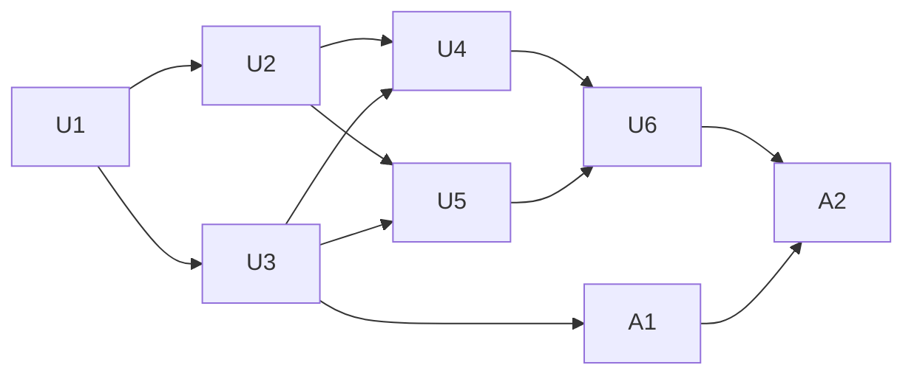

# feat: Add a portable epic orchestration workflow with a merge-queue runner and delivery state

## Outcome

Any adopting repository can deliver a decomposed epic the way the last two epics
were delivered. All it needs is the released corpus and a small repository
binding; nothing has to live in one session's memory.

- **One lead session** plans and assigns tickets to **lane sessions**. It owns
  every merge, every shared resource and every release, and it keeps a live view
  current.
- **Lanes** deliver one ticket at a time under a declared **focused lane profile**
  and never merge.
- A **merge-queue runner** handles one candidate at a time:
  - it confirms the candidate is the head that was reviewed;
  - it syncs the candidate with the current base, allowing only declared
    regenerable changes;
  - it asks a provider, read from the base, which checks the diff requires;
  - it runs those checks on the exact tree it pushed;
  - it merges that exact head, and only when every check passes.
- A **delivery state document and journal** record where the epic stands.
  **Renderers** turn that state into views. The state is the contract; any view
  can be replaced.

The workflow ships in this corpus as a new skill, `orchestrate-work`, reached
through `deliver-work`. The skill carries its executable tools as
standard-library Python with their schemas inside the skill:

- the runner;
- the state tool;
- the renderer wrapper.

A fixture adopter in the test suite proves the workflow runs without any
knowledge of the first adopter.

The first adopter takes on the workflow by policy in its own repository. It
supplies a binding and gains a `lead-merge` mode in its validation planner, so
the runner's checks are selected from the diff instead of a hand-picked list.

## Current-State Evidence

The lead's scratch tooling and the two delivery records show what it actually
ran.

**Lane brief.** Each lane:
- read its ticket and plan unit;
- made a worktree from the latest base;
- ran the unit's named tests first;
- ran two background review lenses (outcome-correctness and adversarial-testing)
  until both approved;
- opened a draft change request and pushed without the repository's full
  pre-push gate;
- sent the lead the change request, head, review rounds and validation.

Lanes never merged. If a candidate added an input only the lead can regenerate
(a new backend module that needs generated API files), the lane said so in its
head message.

**Merge pipeline, one candidate at a time.** The lead's merge checklist also
required that "the diff since review touches only generated files".
1. Merge the base in. Accept conflicts only in regenerable paths (graph
   artifacts, generated agent docs), take the base side, and regenerate.
2. Always regenerate the generated docs, because they drift on branches that
   never merged.
3. Refresh the solution note's diff fingerprint.
4. Push.
5. In a detached checkout of the pushed head, run a fixed check list.
6. Mark ready, re-check mergeability, merge, and confirm the new base head.

**The fixed list was wrong three times.**
- Two always-run tests were added only after the base broke.
- A package's own suite and build were added only after they were missed.
- The list hard-coded one feature directory.

**The merge helper merged whatever the change request's head was at merge
time.** It sent no expected head, so a push between check and merge would have
merged an unchecked head.

**Shared resources and releases.**
- A shared development backend and a payment test mode were leased to one
  holder at a time, through the lead.
- One lead on another machine shared the development backend through a pinned
  coordination thread in the tracker.
- Production releases ran backend first, then clients, from a clean detached
  checkout. Some needed explicit owner approval first.

**Close-out** included one full-health run on the final base.

**Visibility.** A live page read one state document and an append-only
journal, and was updated at every milestone with plain-language copy.
- The state document holds `meta`, `lanes`, `queue`, `ledger`, `finish` and
  `followups`, plus a "being checked now" panel.
- The page was rewritten twice for readability without changing the state's
  shape.
- It also carried adopter-only fields: release markers, `ledger`, per-candidate
  `batch`, `clears` and `timeline`.

**Coordination limits** that shaped the protocol:
- the host paused cross-session messages after ten sends without an operator
  turn;
- session titles drifted from the actual work;
- run telemetry had gaps in what it recorded, so telemetry is strictly
  best-effort.

**What this corpus has today:**
- `deliver-work` routes through a closed `WorkflowKind` set in
  `agent_skills/router.py`. Intent patterns run in order, and `plan` precedes
  `implement`.
- The delivery graph in `workflows/delivery-v1.json` is frozen by a schema
  constant.
- `execute-work` mandates the correctness and testing lenses. `review-work`
  bounds delivery review.
- In this corpus, "posture" means test-first, characterization-first or
  sensor-only.
- `execute-work/scripts/report_observation.py` is the precedent for a shipped,
  optional, standard-library script.
- `agent_skills/locking.py` uses OS-released `fcntl` locks.
- `release.py` ships a fixed list of root schemas. `jsonschema` is a test-only
  dependency.
- Product archives carry `runtime/`, whose content digest must match.
  Generations are immutable, and written bytecode counts as divergence.
- Every core-profile change requires fresh core, linear, provider and bootstrap
  qualification in the same change:
  - `router.py` ships in every profile;
  - the qualification tests byte-compare rebuilt archives against the committed
    records;
  - linear qualification needs a live host attestation.
- `catalog.py` counts routing edges when checking for dependency cycles.
- Core outputs are scanned for leakage. The scan rejects:
  - the adopter's name, ticket ids and machine paths;
  - the words `linear`, `mcp`, `http`/`https`, `sdk`, `oauth` and `credentials`.

**What the first adopter has today:**
- **Planner.** `harness:plan` has three pinned modes. Its pure core does
  caller-based impact selection only when the request carries full source
  snapshots of both base and candidate.
  - Snapshot capture depends on the installed product's tree reader and emits no
    renames.
  - The planner's argv is rewritten before it runs: `validationCheckCommand`
    injects a base ref and turns a fallback membership into test-file arguments.
  - The planner orders checks by prerequisites and pins
    `authority: "legacy-gate"`.
  - An uncovered input or an empty plan throws.
- **Registry gaps.** The registry does not declare:
  - a surface for the shared contracts package;
  - the storefront's architecture lint in its fallback;
  - the compounding check;
  - the graph check for package source changes;
  - relationships for seven of the nine always-run pin tests;
  - an exported, offline check for generated backend API staleness. The
    pre-commit comparison is unexported and lists modules only.
- **Hooks.** Linked worktrees inherit hooks: pre-commit runs a worktree
  bootstrap check, and pre-push runs the full gate.
- **Policy.** Root instructions and four pinned documents name the full gate as
  the only merge-ready authority and forbid substitute suites. Its delivery
  overlay also requires a landed report, a telemetry record, review evidence
  and green hosted checks.

## Execution Posture

- **`test-first`:** the state tool, the renderer wrapper, the runner, the
  provider contract, and the planner mode.
- **`characterization-first`:** the first adopter's snapshot reader and existing
  plan selections.
- **`sensor-only`:** skill text, policy text and registry metadata.

This epic is delivered with the workflow it encodes. Until the runner lands, the
lead uses its scratch pipeline.

## Plan Review Status

Approved on 2026-10-20 after 4 rounds, with both lenses (outcome-correctness and adversarial) unanimous. Evidence is in `2026-10-20-epic-orchestration-workflow.review.json`. There is no round bound.

## Scope

### In scope

1. **The `orchestrate-work` skill:**
   - roles and the lane profile;
   - the coordination protocol;
   - finding triage;
   - base-broken handling;
   - leases and releases with approval gates;
   - the live view and its publishing;
   - close-out.
2. **The `orchestrate` workflow kind,** with intent routing ahead of `plan`.
3. **Schemas inside the skill,** plus a standard-library validator that agrees
   with the test-only reference validator. The schemas are:
   - the binding;
   - the affected-checks exchange;
   - the delivery state;
   - journal entries;
   - the runner's result.
4. **Three standard-library tools** under the skill's `scripts/`:
   - the state tool;
   - the renderer wrapper with two built-in renderers;
   - the merge-queue runner.
5. **Registry, qualification and release** for all four profiles, the product
   runtime, and one release cut.
6. **A fixture adopter** that exercises every tool end to end, including from an
   extracted release.
7. **The first adopter's work:**
   - the `lead-merge` planner mode and the membership gaps;
   - an exported generated-API check and the merge helper's expected head;
   - the binding;
   - installing the release;
   - the policy across every pinned document;
   - migrating the live page to the released state;
   - a live run.

### Out of scope

- New hosts or a session-messaging abstraction. Coordination is behaviour the
  lead performs with whatever the host offers, with a degraded path.
- Changes to the delivery graph or to existing run-event owners.
- Tracker mutations beyond the neutral tracker capability.
- Driving review lenses from the runner.
- A hosted live service.
- Automatic conflict resolution in source files, and merging by auto-merge.

## Contract Decisions

**C1. One skill, one workflow kind, no graph change.**
- `orchestrate-work` is a new core skill.
- `WorkflowKind` gains `orchestrate`. Its intent pattern ("epic", "orchestrate",
  "lanes") is evaluated after `diagnose` and before `plan`, so compound, review
  and diagnose intents keep their precedence.
- `deliver-work` routes `orchestrate` to `$orchestrate-work`, and a repository
  can name it as its workflow.
- Each lane's ticket runs the existing delivery graph through `execute-work`.
- `orchestrate-work`'s dependencies are `execute-work`, `review-work`,
  `plan-work` and `compound-learning` (required), plus the neutral tracker
  capability. It never depends on `deliver-work` or on any tracker-specific
  skill, so the catalog stays acyclic.

**C2. Roles and write ownership.**
- **Lead.** One session. Only the lead:
  - assigns tickets;
  - starts the runner;
  - holds or grants leases;
  - approves releases with the operator;
  - moves tracker items to their final state.

  The lead may also take tickets itself.
- **Lane.** A session, or in degraded mode a subagent or the lead itself. A
  lane:
  - delivers one assigned ticket at a time;
  - never merges, releases, or holds an ungranted lease.
- **State writers.**
  - The lead writes every state field except the runner-owned ones.
  - The runner writes only its result documents, journal entries, and these
    runner-owned fields: `queue[i].stage`, `queue[i].checks`,
    `queue[i].syncedHead`, `meta.checking`, `meta.baseHead` and
    `meta.releasedHead`.
  - All writes go through the state tool. Each write takes a short state lock,
    which is separate from the runner's long-held queue lock. The tool checks
    the declared writer role (`lead` or `runner`) against this ownership.

**C3. The focused lane profile.** This is a named profile, not a posture.
- Run the unit's named tests first.
- Run the unit's declared sensors only. There is no repository-wide gate and
  no full suite.
- Run the two mandated lenses until both approve, within `review-work`'s bound.
- Run the repository's compounding check.
- Open a draft change request.

The hand-off contains:
- the candidate reference;
- the reviewed head;
- the review rounds;
- the validation;
- the run id, or `none`;
- every declared lead input the candidate needs.

The lead records the hand-off in `queue[]`, including `head` and `leadInputs`.

**C4. Coordination protocol.** These rules are host-neutral.
- Send one consolidated message per lane per milestone.
- Retitle a lane in the same step as its assignment.
- Keep undelivered messages in the lead's notes, and alert the operator once.
- Treat a lane's report as a claim to check.

With no session capability, the lead runs lanes as subagents or sequentially.
Lease holders may be outside the epic, for example a peer lead elsewhere. The
skill records them as named holders and states the request, acknowledge, start,
done and release sequence.

**C5. Finding triage.**
- Blocking findings are fixed in the lane.
- Cheap non-blocking findings (about an hour or less) are fixed in the lane,
  with no ticket.
- Expensive non-blocking findings go to the lead, who defers them with a
  tracker follow-up or drops them, and records a decision.
- A finding first raised in a later round, against code an earlier round
  approved, is judged on scope before it blocks.

**C6. Binding (`orchestration-binding/1`, `.agents/orchestration.json`).**

Every command is an argv array. There are no shell strings. The placeholders
are:

`{candidate}`, `{branch}`, `{head}`, `{expectedHead}`, `{base}`, `{baseHead}`,
`{treeSha}`, `{ref}` and `{workRoot}`.

A placeholder replaces a whole argv element, or a whole environment value. It
never substitutes inside a longer string.

The binding declares:

| Field | Contents |
| --- | --- |
| `base` | `{remote, ref}` |
| `workRoot` | The directory for temporary checkouts. |
| `candidate` | An argv that resolves a candidate reference to `{branch, head}` as JSON. |
| `prepare` | An argv list run in every fresh checkout, for example installing dependencies or creating a ref the checks need from `{baseHead}`. |
| `hooks` | `bypass` or `run`. `bypass` means every git command the runner issues (merge, commit, push, checkout) uses `-c core.hooksPath=<empty directory under workRoot>`, and the runner records that it did. |
| `regenerable` | Exact files or patterns, each declared generated-only, plus the regenerator argv list. |
| `postSync` | Entries of `{argv, paths}`. Each entry declares the paths it may change, for example a fingerprint refresh that writes into solution notes. |
| `leadInputs` | Each input's id, its argv, the paths it may change, and the lease it needs, if any. |
| `profiles` | `{name: {environment}}`, with placeholder values (`{head}`, `{baseHead}`, `{treeSha}`). A check names one profile, and the runner refuses an unknown profile. |
| `provider` | `{argv, cwd, timeoutSeconds}`, plus `providerInputs`: the paths whose change makes the candidate's own provider selection run as well. |
| `alwaysRun` | Checks in the affected-check entry shape. |
| `fallback` | Checks in the affected-check entry shape. |
| `checkTimeoutSeconds` | The default timeout. |
| `checkTimeoutCeiling` | The maximum timeout. |
| `environment` | Variables set for every argv the runner runs. |
| `ready` | An argv. |
| `merge` | An argv that must use `{expectedHead}`. A binding whose `merge` lacks it is invalid. |
| `release` | Ordered targets, each with an `id`, an `argv`, `stopsOnFailure` and `requiresApproval`. |
| `fullHealth` | The argv for the close-out run. |
| `leases` | Each lease's id, description, default holder, and optional `materialize` and `withdraw` argv. |
| `state` | `{directory, renderers, publishers}` |

The runner reads the binding from the **base** checkout, never from the
candidate.

**C7. Affected-checks provider (`affected-checks/1`).**

The input is `{base, baseHead, head, changes:[{path, status, oldPath?}]}`,
passed on stdin. The runner computes `changes` with git rename detection.

The output is `{checks:[{id, argv, cwd, reasons, prerequisites,
environmentProfile?, timeoutSeconds?}], widened, uncovered:[paths], notes?}`.

The runner validates the output and refuses it as malformed if any of these
fails:
- every argv is a non-empty list of strings;
- every `cwd` resolves inside the checkout;
- ids are unique;
- every prerequisite names a selected check;
- the prerequisites contain no cycle;
- every timeout is at or below the ceiling.

Checks run in prerequisite order. A timed-out check is killed with its whole
process group.

Every checkout the runner uses has `prepare` run in it and the candidate's
objects fetched: the provider's base checkout, the candidate's synced checkout,
and the base re-run checkout.

**Selection.** The provider runs from the base checkout. When the candidate
changes any `providerInputs`, the runner also runs the candidate checkout's
provider and takes the union. The final selection is `provider ∪ alwaysRun`,
and `fallback` is added to it when:
- the provider is missing, failed, timed out or malformed;
- `uncovered` is non-empty;
- the provider selected nothing although there are changes.

If the final selection is still empty while there are changes, the candidate
stops as `no_checks`. Unknown impact always widens the selection.

**C8. Runner (`merge_queue.py`).**

The subcommands are:
- `sync <candidate>`;
- `check <candidate>`;
- `merge <candidate>`;
- `run <candidate>...`, which does sync, check and merge in order, stopping at
  the first failure;
- `release <ref> [--approved-by <text>]`.

Startup and isolation:
- At startup the runner takes an OS-released lock for the queue. It prunes
  stale checkouts and stale worktree registrations under `workRoot`.
- It works only in detached temporary checkouts under `workRoot`.
- It never touches the operator's checkout or the base branch.
- Refs are validated with `check-ref-format` and passed after `--`.

**Sync:**
1. Resolve the candidate. Its head must equal either the reviewed head
   (`queue[].head`) or the runner's last pushed sync (`queue[].syncedHead`).
   Otherwise stop with `candidate_moved`.
2. Merge the base in. If any conflict is outside `regenerable`, stop with
   `source_conflict`, list the paths, and push nothing. Otherwise take the base
   side for the regenerable conflicts and **commit the merge**, so every later
   step sees the new merge base.
3. Run, in order:
   - the lead inputs the hand-off named;
   - the regenerators;
   - the `postSync` entries.

   Commit each pass separately.

   Before any lead input that needs a lease runs:
   - check that the lead holds that lease in `leases[]`. If not, stop with
     `lease_required`;
   - only then run the lease's `materialize` argv in the sync checkout. It
     writes the lease marker or environment the input needs;
   - run the lease's `withdraw` argv on every exit from the input (success,
     failure or timeout), before anything is committed. If `withdraw` fails,
     stop with `lease_withdraw_failed` and push nothing.

   No other checkout ever receives lease material.
4. Repeat step 3 until a pass produces no diff, at most twice. If the last pass
   still produces a diff, stop with `unstable_regeneration`.
5. Reserved; the lease check now sits inside step 3.
6. Check the result:
   - Any working-tree change outside the declared paths stops the candidate
     with `undeclared_change`. The declared paths are `regenerable`, the
     `postSync` paths and the named lead inputs' paths.
   - Compute the reference result with
     `git merge-tree --write-tree <reviewed head> <baseHead>`. With the declared
     paths removed from both, the synced tree must equal that result. Otherwise
     stop with `unreviewed_change`. This comparison always starts from the
     reviewed head.
7. Push to `refs/heads/<branch>` with
   `--force-with-lease=<branch>:<resolved head>`, refusing the base branch.
   Record `queue[].syncedHead`.

**Check:**
1. Make a fresh clean checkout of the pushed synced head and run `prepare`.
2. Assert the working tree is clean.
3. Select the checks (C7) and run them.
4. Assert the tree is still clean.
5. A failing check stops the candidate with `check_failed`. It is classified
   as `base_broken` instead, stopping the whole queue, only when all of these
   hold:
   - every path the argv names exists at `baseHead` and is unchanged by the
     candidate;
   - re-running it on a fresh checkout of `baseHead` also fails.

**Merge:**
1. Re-resolve the candidate.
2. If its head differs from the synced head, stop with `candidate_moved`.
3. If the base moved since the check, report `base_moved`. In that case `run`
   re-syncs and re-checks once, and a second `base_moved` stops.
4. Run `ready`. If it exits non-zero, stop with `ready_refused`; for example, an
   adopter whose `ready` waits on hosted checks. Then run `merge` with
   `{expectedHead}` set to the synced head. If it exits non-zero, stop with
   `merge_refused`.
5. Confirm that the new base's tree equals the synced head's tree and that its
   first parent is the checked `baseHead`.
6. If that confirmation fails, record `merged_unverified` and stop the queue.

**Release:**
1. Refuse a ref that is not the base tip or one of its ancestors.
2. Make a clean detached checkout and run `prepare`.
3. Run the targets in order. Each target with `requiresApproval` needs
   `--approved-by`, which is recorded with it. The flag is a record of an
   approval the operator already gave, not a gate the runner can verify. The
   skill says the lead passes it only after the operator approves in chat.
4. Stop at the first failure of a target with `stopsOnFailure`.

Every subcommand writes a `merge-queue-result/1` document, the journal entries,
and its own fields (C2).

**C9. Delivery state (`delivery-state/1`) and journal (`delivery-journal/1`).**

The state document has these fields:

| Field | Contents |
| --- | --- |
| `schemaVersion` | |
| `version` | |
| `meta` | `headline`, `updatedAt`, `baseHead`, `releasedHead`, `checking{now{subject, title, startedAt, steps}, next[]}` |
| `lanes[]` | `id`, `title`, `focus`, `state`, `waitingOn`, `since` |
| `queue[]` | `order`, `subject`, `title`, `lane`, `stage`, `head`, `syncedHead`, `leadInputs`, `reportedRounds`, `runId`, `checks` |
| `finish[]` | |
| `followups[]` | |
| `leases[]` | `id`, `holder`, `since` |
| `extensions` | An object for adopter fields. It is validated as an object only, renderers may read it, and the runner never writes it. |

The journal is append-only. Each entry is `{id, at, kind, lane, subject,
summary}`, and `kind` is one of:

- `lane.assigned`, `candidate.handed`, `check.started`, `check.finished`;
- `candidate.merged`, `candidate.stopped`, `base.broken`, `base.repaired`;
- `lease.granted`, `lease.released`, `release.started`, `release.finished`;
- `finish.met`, `decision.recorded`, `blocker.recorded`, `delivery.closed`.

These are orchestration events. Per-run events stay with their owners, and the
state only links a candidate's `runId`.

**C10. State tool (`delivery_state.py`).**

Subcommands:
- `init`;
- `validate`;
- `patch`, with `--writer lead|runner`, pinned to `version`. A stale version is
  refused. It applies either:
  - a JSON merge patch to the top-level fields the writer owns; or
  - element-scoped updates (`queue[subject=…]`, `lanes[id=…]`) to the fields
    the writer owns.

  A write to a field the writer does not own is refused.
- `journal`, an append. It is serialized under the lock, never refused for
  concurrency, and allocates the next id.
- `show`.

Every write:
- takes the OS-released lock;
- validates against the schema;
- bumps `version` and `meta.updatedAt`;
- writes to a temporary file and replaces the original atomically.

The tools are standard-library only:
- schemas live under the skill's `references/schemas/`, with `urn:` ids and no
  `$schema` member, so they pass the leakage scan. The reference test selects
  the draft 2020-12 validator explicitly;
- a bundled validator covers the schema subset the schemas use;
- each script sets `sys.dont_write_bytecode` before importing a sibling module,
  and the skill says to run the scripts with `-B`.

**C11. Renderers and publishers (`render_state.py`).**

- **Renderer.** Any argv that reads the validated `{state, journal}` on stdin
  and writes a view on stdout.
- **Publisher.** Any argv that receives the same input and puts it somewhere a
  view reads, for example a live store. Publishers are optional.

The wrapper validates first, then runs the declared renderers and publishers.
When the runner writes state, it calls the wrapper. A failing publisher is
recorded and never fails the runner.

There are two built-in renderers.
- **`markdown`.** It neutralises links and raw HTML in state text.
- **`static-page`.** A self-contained page:
  - it embeds the state as JSON, escaping `<`, `>`, `&`, U+2028 and U+2029;
  - it renders through text content only;
  - it makes no external loads.

  It can instead read a live store through a small, declared adapter object
  that the hosting environment provides. The page checks the store's
  `schemaVersion` and falls back to the embedded state on a mismatch or when
  the adapter is absent.

When a host stores state with its own tool rather than an argv, publishing is a
lead step in the checklist, done after each runner result.

**C12. Base-broken handling.** When the runner reports `base_broken`, the queue
stops. The lead then:
- fixes forward first;
- declares the missing provider membership, or adds the check to `alwaysRun`;
- records a decision.

**C13. Telemetry is best-effort.** Each existing run emission is attempted at
most once. Failures are skipped and never delay, gate or reorder the delivery.

**C14. Leakage.** Every new core file passes the leakage scan:
- the tools name no host, tracker or forge, and call only `git` and argv
  declared in the binding;
- the static page uses no `http-equiv`, namespaced SVG, `linear-gradient` or
  `linear` easing, or fetch options naming credentials;
- the skill refers to "the tracker capability" by role.

Plan-unit identifiers stay out of skill text, scripts and schemas.

## Implementation Units

**Corpus units land on one integration branch,
`orchestration-workflow-integration`, which merges into the default branch once,
together with U6.**

**Qualification pending.** U1 adds a marker file, `qualification-pending.json`.
It names the qualification sets whose records are stale:
- core;
- linear;
- provider;
- bootstrap.

While the marker exists:
- the qualification byte-comparison tests for those sets skip, with the
  marker's reason;
- the release-cutting command (`scripts/build-release.py`'s CLI) refuses to
  cut a release. The `build_release` library function the tests call is
  untouched, so test builds keep working;
- `scripts/validate-registry.py --target-base <ref>` refuses the marker when
  `<ref>` is the default branch. Without that argument, validation stays
  tree-only, as `validate_corpus` is today. CI passes the argument on pushes
  to the default branch and on pull requests targeting it, using a step added
  to `.github/workflows/ci.yml`.

The integration branch's final merge procedure asserts the marker is absent
before merging.

The same skip applies locally and in hosted CI, so integration pull requests are
judged on a green suite. The sensors are the ordinary commands, with no manual
exclusions. U6 deletes the marker and re-earns every set. The default branch
can never carry the marker, so it can never skip qualification.

**Merge procedure.** The lead merges each unit into the integration branch only
after:
- the lane's two-lens review approves;
- the full corpus suite passes on the synced head.

Before U3 lands, the lead does this by hand. After U3, the lead may run the
runner with a corpus binding as a dogfood exercise. That is optional and not
required.

**Shared files.** Each unit owns its additions to:
- the catalog entry;
- `profiles/core.json` and `profiles/linear.json` `expectedFiles`;
- the provenance outputs and their digests;
- the core file pins in `tests/test_registry.py` and
  `tests/test_core_boundary.py`;
- the `validation-inventory.json` scenario rows and `expectedScenarioCount`
  for its core and linear coverage.

### U1. Skill skeleton, state schemas and the state tool

**Goal:** A registered skill, and a validated, versioned state document and
journal with a tool that refuses stale or malformed writes.

**Posture:** `test-first`.

**Dependencies:** None.

**Ownership:**
- `skills/orchestrate-work/SKILL.md`, as a skeleton: front matter, purpose, and
  a pointer to its tools;
- `skills/orchestrate-work/references/schemas/delivery-state.json`;
- `skills/orchestrate-work/references/schemas/delivery-journal.json`;
- `skills/orchestrate-work/scripts/_schema.py`, the bundled validator;
- `skills/orchestrate-work/scripts/delivery_state.py`;
- `tests/test_orchestration_state.py`;
- the catalog entry, with its dependencies per C1;
- the `qualification-pending.json` marker;
- its validation and the test skips it gates;
- the release-cutting CLI's refusal;
- `validate-registry.py --target-base`;
- the `ci.yml` step that passes `--target-base`;
- the shared-file additions listed above, including the skill's first
  `validation-inventory.json` scenario rows.

**Approach:**
1. Write the schemas.
2. Write the validator, and test that it agrees with the test-only reference
   validator on every positive and negative fixture.
3. Write the tool per C10, with an injectable seam between its read and its
   write so concurrency tests are deterministic.

**Required scenarios:**
- Init, patch, show round-trips.
- A stale version is refused and nothing is written.
- Invalid patches are refused.
- Journal ids stay sequential across restarts.
- An unknown journal kind is refused.
- Through the seam, a stale patch is refused while a concurrent journal append
  succeeds.
- The validator agrees with the reference validator on every fixture.
- No bytecode is written next to the scripts.
- The schemas pass the leakage scan.
- The marker skips only the sets it names.
- With the marker present:
  - the release-cutting CLI refuses;
  - `validate-registry.py --target-base <default>` fails;
  - the same command without `--target-base` passes;
  - `test_profile_inventory` and `test_release_integration` still pass.
- The CI step passes `--target-base` for default-branch events.
- `patch --writer runner` on a lead-owned field is refused, and
  `queue[subject=…]` updates only that element.
- A long-held queue lock does not block a `patch` from the lead.

### U2. Renderer wrapper, built-in renderers and publishers

**Goal:** Views are pure functions of validated state, swappable without
touching state.

**Posture:** `test-first`.

**Dependencies:** U1.

**Ownership:**
- `skills/orchestrate-work/scripts/render_state.py`;
- `skills/orchestrate-work/scripts/renderers/`;
- `tests/test_orchestration_render.py`;
- the shared-file additions.

**Approach:** Implement C11.

**Required scenarios:**
- The same state renders identically twice.
- An invalid state is refused before any renderer runs.
- An adopter renderer receives exactly the validated state.
- Escaping:
  - state text containing `</script>`, ``, U+2028 and markdown
    links renders inert in both built-ins;
  - the page output has no external references;
  - the leakage scan passes on the page template.
- Live store:
  - a store returning a different `schemaVersion` falls back to the embedded
    state;
  - with no adapter, the embedded state is shown.
- A failing publisher is recorded and does not fail the wrapper.
- `extensions` reaches renderers unchanged.

### U3. Binding, provider contract and merge-queue runner

**Goal:** One candidate at a time is synced, checked by a provider selection
read from the base, and merged at its exact checked head, with honest stop
reasons.

**Posture:** `test-first`.

**Dependencies:** U1.

**Ownership:**
- `skills/orchestrate-work/references/schemas/` for the binding,
  `affected-checks` and `merge-queue-result`;
- `skills/orchestrate-work/scripts/merge_queue.py`;
- `tests/test_merge_queue.py`;
- the shared-file additions.

**Approach:**
- Implement C6–C8.
- Use git through `subprocess` with no shell.
- Kill timed-out checks by process group.
- Use the U1 tool and lock for every state write.
- Make each race in the tests deterministic with a recording fake.

**Required scenarios:**
- **Candidate pinning:**
  - a clean candidate merges with `{expectedHead}` set to the synced head;
  - the new base tree equals the synced tree, and its first parent equals the
    checked base;
  - a push between check and merge stops the candidate with `candidate_moved`.
- **Sync safety:**
  - a lane's stale generated file is regenerated and merged without stopping;
  - a generated-only conflict is resolved, the merge committed before
    `postSync`, the result regenerated, and the candidate merged;
  - a `postSync` step that reads the merge base sees the new base;
  - a fingerprint-style `postSync` writing its declared path passes;
  - a source conflict stops and pushes nothing;
  - a `postSync` step that changes an undeclared file stops with
    `undeclared_change`;
  - a lane push after review stops with `unreviewed_change`;
  - a non-converging regenerator stops with `unstable_regeneration`;
  - the push uses a lease, and pushing to the base branch is refused;
  - a re-sync after `base_moved` accepts the runner's own `syncedHead`;
  - a lease-needing lead input without the lead holding the lease stops with
    `lease_required`;
  - with the lease held, the material exists only during the input, and a
    check checkout never has it;
  - a leased input that fails or times out still leaves no material behind;
  - every git command, including the merge, runs with the empty hooks
    directory.
- **Selection:**
  - a candidate that edits the binding or a provider input cannot shrink its
    own selection;
  - a missing, failing, malformed or timed-out provider falls back and records
    why;
  - an empty selection while there are changes falls back, and if still empty
    stops with `no_checks`;
  - a non-empty `uncovered` adds the fallback;
  - prerequisites run in order;
  - a cycle or an out-of-tree `cwd` is refused;
  - a check that spawns a child is killed with it on timeout.
- **Failures:**
  - a provider-selected check (not in `alwaysRun`) whose test already fails on
    the base stops the queue with `base_broken`;
  - a check naming a test file the candidate adds, which fails, stops only the
    candidate with `check_failed`;
  - a check that fails only on the candidate stops with `check_failed`;
  - a refusing `ready` stops with `ready_refused`, and a refusing `merge`
    stops with `merge_refused`;
  - an unknown environment profile is refused;
  - a recording fake that advances the base yields `base_moved`, then a
    successful re-sync, and a second advance stops the candidate;
  - a merge whose resulting tree differs records `merged_unverified`.
- **Release:**
  - a ref that is not on the base is refused;
  - an approval target without `--approved-by` is refused;
  - targets run in order and stop at the first stopping failure.
- **Isolation:**
  - a second runner waits on, or is refused by, the lock;
  - stale checkouts from a killed run are pruned at the next start;
  - the operator's checkout and the base branch are never written.

### U4. The skill text, the workflow kind and routing

**Goal:** A lead holding only the released corpus and a binding can run an
epic.

**Posture:** `sensor-only` for the text; `test-first` for routing.

**Dependencies:** U1, U2 and U3, because the skill references their contracts.

**Ownership:**
- the full `skills/orchestrate-work/SKILL.md`;
- `skills/orchestrate-work/references/`, holding:
  - the lane brief template;
  - the lead checklist;
  - the binding guide;
  - the coordination protocol;
  - triage and base-broken rules;
  - the publishing step;
- `agent_skills/router.py`;
- `skills/deliver-work/SKILL.md`;
- `tests/scenarios/core/routing.json` and the router tests;
- the shared-file additions.

**Approach:** Write C1–C5 and C12–C13 as the skill. The lead checklist covers:
1. plan;
2. decompose through the tracker capability;
3. assign;
4. run the queue;
5. publish;
6. live checks against the finish lines;
7. release with approval;
8. close-out:
   - one `fullHealth` run on the final base;
   - finish lines;
   - tracker final states;
   - follow-ups;
   - base alignment.

**Required scenarios:**
- Each of these intents routes to `orchestrate` ahead of `plan`:
  - "deliver this epic";
  - "orchestrate the lanes";
  - "deliver the epic from the plan".
- "plan the feature" still routes to `plan`.
- "review the epic" still routes to `review`.
- An unknown named workflow returns `clarify`.
- The link, resource and leakage checks pass.
- The skill text names no host, tracker or forge, and no plan-unit identifiers.

### U5. Fixture adopter

**Goal:** Proof that the workflow runs with no first-adopter knowledge.

**Posture:** `test-first`.

**Dependencies:** U1, U2 and U3.

**Ownership:**
- `tests/fixtures/orchestration-adopter/`, holding:
  - a repository template;
  - its binding;
  - a Python provider;
  - a regenerator;
  - recording fakes for `ready` and `merge`;
- `tests/test_orchestration_adopter.py`;
- the shared-file additions, if any.

**Approach:**
1. Build the repositories in a temporary work root whose path contains spaces:
   - a bare remote named `upstream`, with base branch `trunk`;
   - a working repository.
2. Create three candidates: one clean, one with a generated-only conflict, and
   one with a source conflict.
3. Drive the full workflow:
   1. `init`;
   2. assign;
   3. `run` all three;
   4. the lane fixes candidate 3, then a re-run;
   5. a provider outage on one run;
   6. a broken-base episode;
   7. release with approval;
   8. render both built-ins.
4. Scan the tool sources for adopter-default literals. The scan matches quoted
   string forms and `refs/heads/` forms only, so `__main__` does not match. It
   looks for:
   - `"origin"`;
   - `"main"` and `refs/heads/main`;
   - a package-runner name;
   - `--no-verify`;
   - a forge CLI name.

   The runner's own hooks bypass is the `core.hooksPath` mechanism, which the
   scan allows.

**Required scenarios:**
- S1, S2 and S4 below run end to end.
- The final state shows three merged candidates, the released head, and the
  expected journal kind sequence.
- Both renders succeed.
- No first-adopter term appears in the fixture.
- No adopter-default literal appears in the tools.

### U6. Registry, qualification, runtime and release

**Goal:** The new skill is released exactly, with fresh qualification for every
profile, and the integration branch merges.

**Posture:** `sensor-only`, plus the repository's validation commands.

**Dependencies:** U4 and U5.

**Ownership:**
- the final catalog and profile descriptions;
- `deliver-work`'s routing dependency on `orchestrate-work`;
- the `validation-inventory.json` scenarios and `expectedScenarioCount`;
- the payload lists in `agent_skills/release.py`, if needed;
- the required scenarios in the qualification scripts, and fresh records for
  core, linear, provider and bootstrap;
- the product runtime rebuild and its `workflowContentSha256`;
- the product zip and release files;
- the current-set pointers in the qualification tests;
- the README and the `docs/` pages for the new contracts;
- the linear live host attestation;
- the integration branch's single merge.

**Approach:**
1. Delete the `qualification-pending.json` marker.
2. Re-earn every profile's qualification under a new set name. Retained records,
   including the concurrent-delivery set, keep their bytes, as AGENTS.md
   requires.
3. Rebuild the runtime.
4. Have the lead collect the live host attestation in a real host session.
5. Cut one release, and run the U5 adopter flow against the extracted release
   archive.

**Required scenarios:**
- With the marker deleted, registry validation and the full unit suite pass,
  and nothing skips.
- Every profile's qualification records the new scenarios.
- Release build and verify succeed.
- The leakage check passes on the archive.
- Running the tools from the extracted, immutable generation writes no bytes
  into it.

### A1. Adopter: `lead-merge` planner mode and membership gaps

**Goal:** The first adopter's planner answers `affected-checks/1` for a
`base..head` diff, with no installed product, no network and no health
authority.

**Posture:** `characterization-first`, then `test-first`.

**Dependencies:** U3, merged into the integration branch, which owns the
exchange schema.

**Ownership** (adopter repository):
- the planner CLI's `lead-merge` mode;
- an in-repo git snapshot reader;
- the request builder and output mapping;
- the canonical registry's missing memberships;
- the exported generated-API check CLI and its blocker-inventory registration;
- these pins:
  - `VALIDATION_PLAN_POLICY.modes`;
  - `VALIDATION_PLAN_POLICY.sharedInputs`;
  - the help text;
  - the `authority` and `evidence` values;
  - the report fixture;
  - the import-boundary copy list;
  - relationship ids;
- the regenerated health inventory and generated docs.

**Approach:**
- **The mode.** `lead-merge` reads `affected-checks/1` input on stdin.
  - It builds base and candidate snapshots with `git cat-file --batch`,
    resolving symlinks the way native capture does.
  - It sets `inventory` from the candidate's tree listing and takes `changes`
    from stdin.
  - It runs the existing selection and maps each check through
    `validationCheckCommand` unchanged.
    - That keeps the `refs/delivery/base` ref the command expects. The binding's
      `prepare` creates it from `{baseHead}`.
    - `packageScripts` is read from the candidate snapshot's `package.json`
      files.
  - It outputs prerequisites and the named environment profile the adopter's
    selection guard needs. That profile carries the head, tree and base
    variables. `authority` is `"lead-merge"`, and `evidence` is
    `"not-evaluated"`.
  - In this mode, uncovered paths are collected rather than thrown. Selection
    continues for every covered path, and the output reports `widened: true`
    with the full `uncovered` list. A thrown `empty-plan` maps to an empty
    selection with a note.
- **Missing memberships.** Declare:
  - the contracts surface, selecting both apps;
  - the storefront architecture lint in its fallback;
  - the compounding check;
  - the graph check for package source;
  - relationships for the seven pin tests that read the tree;
  - the generated-API check, which compares the module list offline.

  A `convex.config.ts` change is not checked offline. It is a binding lead
  input that needs the development-backend lease.
- **Characterization first.** Show that the git reader produces the same
  snapshots and changes as native capture for identical refs, where native
  capture is available. Show that existing fixture selections change only where
  a new membership applies.

**Required scenarios:**
- A storefront-only diff selects the storefront suite, typecheck, architecture
  lint and asset build.
- A contracts change selects both apps.
- A backend helper change selects its callers' tests and the admission
  coverage test.
- A new backend module without regenerated files selects the generated-API
  check, which fails.
- A docs-only diff selects only the doc checks.
- With the installed product absent, the mode still plans.
- An unparseable change widens.
- A diff mixing covered and uncovered paths keeps the covered paths' selection
  and lists every uncovered path.
- A rename is planned as a rename.
- The emitted argv run unchanged in a checkout that has `refs/delivery/base`.

### A2. Adopter: binding, install, policy, live page and a live run

**Goal:** The first adopter runs its next epic from the released workflow.

**Posture:** `sensor-only` for policy and binding, plus a live run.

**Dependencies:** U6 (released) and A1.

**Ownership** (adopter repository):
- `.agents/orchestration.json`:
  - exact generated files as regenerable;
  - regenerators;
  - the fingerprint refresh in `postSync`;
  - lead inputs: backend module codegen and the backend config change, both
    needing the lease;
  - `prepare`: installing dependencies and creating `refs/delivery/base` from
    `{baseHead}`. It never supplies lease material: the development-backend
    lease declares `materialize` and `withdraw`, which write and remove its
    marker and environment around a leased lead input only;
  - the environment profiles the planner emits;
  - hooks bypassed;
  - the provider: A1;
  - a minimal `alwaysRun`;
  - `fallback`: the previous fixed list;
  - environment pins;
  - ready and merge through the merge helper with `{expectedHead}`;
  - release targets, backend then clients, with the production targets
    `requiresApproval`;
  - `fullHealth`;
  - leases;
  - state, renderers and publishers;
- the merge helper's `--expected-head`, which sends the API's `sha`, and its
  test;
- installing the release;
- the policy in:
  - root `AGENTS.md`;
  - `packages/athena-webapp/AGENTS.md`;
  - `docs/agent/index.md`;
  - `docs/agent/testing.md`;
  - the `ce-commit-push-pr` skill;
  - the guidance-contract test;
- the harness guide section;
- a solution note;
- migrating the live page:
  - it becomes a renderer over `delivery-state/1`;
  - the adopter-only fields move into `extensions`;
  - the old journal is archived, and new entries use the released kinds.

**Policy content:**
- The policy names an "epic orchestration" workflow beside the full gate, as
  the owner approved on 2026-10-20.
- For epic deliveries, it states which overlay duties the workflow replaces:
  - the full repository gate per change request;
  - the landed report;
  - the telemetry record;
  - the review-evidence obligation;
  - green hosted checks, but only while the adopter's hosted-check exception
    holds (it expires 2026-12-01). After it lapses, the binding's `ready` waits
    for green hosted checks and refuses otherwise. The policy states this.
- It also states which duties remain:
  - the two-lens lane review;
  - the compounding check;
  - the harness check;
  - provider-selected checks;
  - one full-health run at close-out;
  - approval-gated production releases.
- It names the hook bypass.

**Required scenarios:**
- The runner merges one real candidate through the binding with
  provider-selected checks and a pinned head.
- The live page renders the state the runner wrote, after the declared publish
  step.
- The guidance-contract test passes.
- The installed release verifies.
- The migrated live page renders `</script>`, markup and U+2028 in state and
  `extensions` text inert.

## Dependency Graph

The prose is authoritative.
- **In parallel:** U2 and U3 can run after U1. A1 can run alongside U4 and U5,
  once U3 has merged into the integration branch.
- **Shared ownership:** corpus units share the integration branch's registry
  files. The lead's queue serializes them, and each unit owns only its own
  additions.

## Representative End-to-End Scenarios

- **S1. Fixture epic.** Three candidates come in:
  1. the runner merges two;
  2. it stops the third on a source conflict;
  3. the lane fixes it;
  4. a re-run merges it;
  5. an approved release succeeds.

  The markdown view reads correctly at each step.
- **S2. Provider down.** The provider exits non-zero. The runner falls back,
  records why, and the view's "checks now" names the fallback.
- **S3. Base moved.** A merge lands between a candidate's check and its merge:
  1. the runner refuses;
  2. it re-syncs;
  3. it re-checks;
  4. it merges at the new pinned head.
- **S4. Base broken.** A provider-selected check fails on the base as well:
  1. its referenced paths are unchanged by the candidate, and the base re-run
     also fails;
  2. the queue stops with `base_broken`;
  3. the fixture's fix-forward lands;
  4. the check joins `alwaysRun`;
  5. later candidates run it.
- **S5. A lane pushes after review.** The runner stops with `candidate_moved`
  or `unreviewed_change`, and nothing merges.
- **S6. First adopter, real candidate.** A real candidate passes through the
  binding with A1's selection and a pinned head. The live page shows the merge.

## Repository Sensors

**Corpus:**
- `python3 scripts/bootstrap-test-environment.py`
- `.venv/bin/python scripts/validate-registry.py`
- `.venv/bin/python tests/test_registry.py`
- `.venv/bin/python -m unittest discover -s tests -t . -p 'test_*.py'`,
  unchanged. On the integration branch, the qualification-pending marker makes
  the stale-record tests skip.
- `scripts/check-core-leakage.py`
- The qualification scripts for all four profiles, at U6.
- Release build and verify, at U6.

**Adopter** (discovered from its instructions):
- the planner and registry focused tests;
- the harness test suite, because its scripts change;
- the harness check;
- the guidance-contract test;
- the merge-helper test;
- the release verify;
- one live runner pass.

## Risks and Mitigations

- **Qualification churn.** The integration branch, the qualification-pending
  marker, and one release cut together keep each unit's change small. The
  release builder and the default-branch validation refuse the marker, so a
  skipped qualification can never ship.
- **The runner merges something unchecked.** Head pinning, the
  `unreviewed_change` check, the clean-tree assertion, the required
  `{expectedHead}` in `merge`, and the tree and parent confirmation each close a
  path. Every one has a scenario.
- **A candidate certifies itself.** The binding and provider are read from the
  base, and the candidate's own selection runs as well only when it changes
  provider inputs.
- **The provider under-selects.** Unknown impact widens, `uncovered` adds the
  fallback, an empty selection stops the candidate, and base-broken handling
  makes the check permanent.
- **Leakage or injection in the page.** U2 includes escaping and scan
  scenarios, and C14 lists the banned constructs.
- **Adopter pinned guidance.** A2 owns all five pinned documents and the
  contract test, under the owner's 2026-10-20 approval.
- **Linear attestation needs a live host.** U6 names the lead as the collector.
  Without it, the release cannot be cut, and that stays a visible blocker.

## Observable Finish Line

1. **A release.** It carries `orchestrate-work`, its three tools and their
   schemas, with fresh qualification for core, linear, provider and bootstrap.
   Its tools run from the extracted generation without writing to it.
2. **The fixture adopter test.** It runs S1–S5 end to end and contains no
   first-adopter term or adopter-default literal.
3. **The first adopter is set up.** It has:
   - the release installed;
   - a binding;
   - the policy, passing its contract test;
   - a `lead-merge` planner mode answering `affected-checks/1`.
4. **One real merge.** One real candidate in the first adopter merged through
   the runner with provider-selected checks and a pinned head. Its live page
   shows the merge, rendered from the runner's state.
