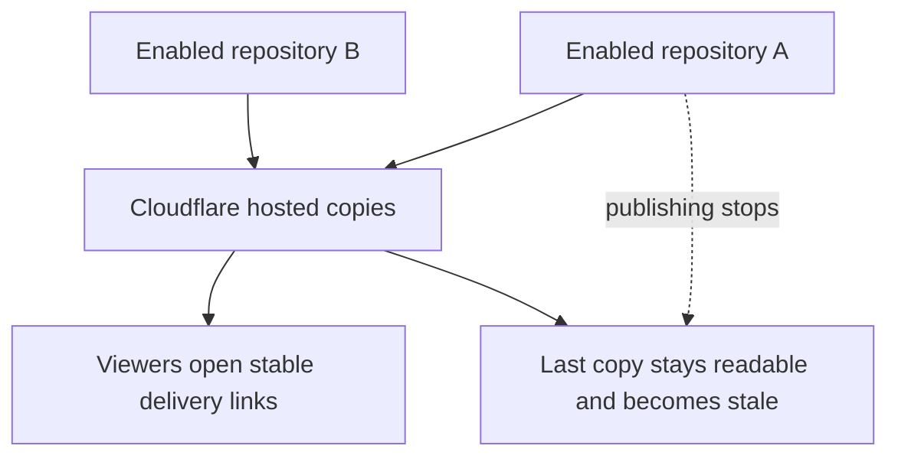
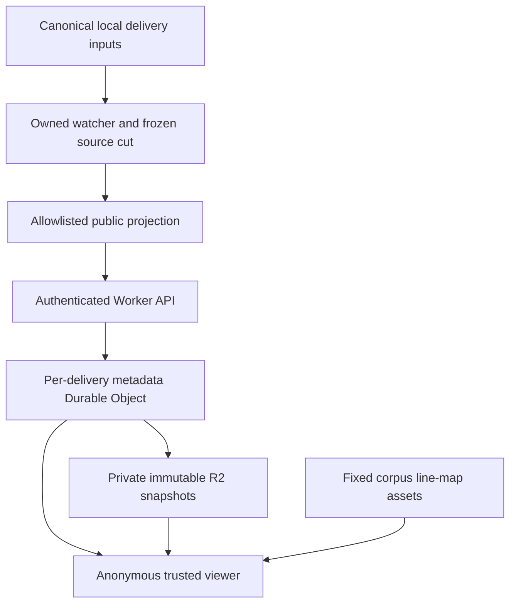
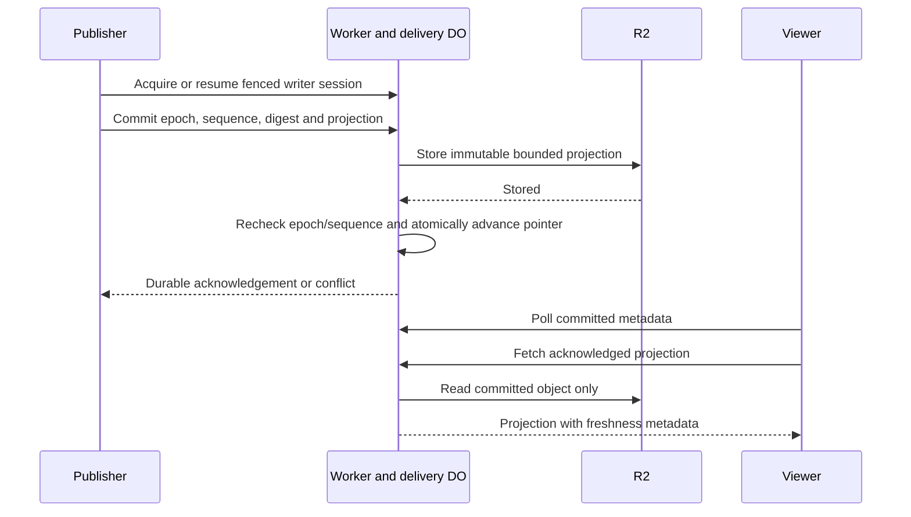
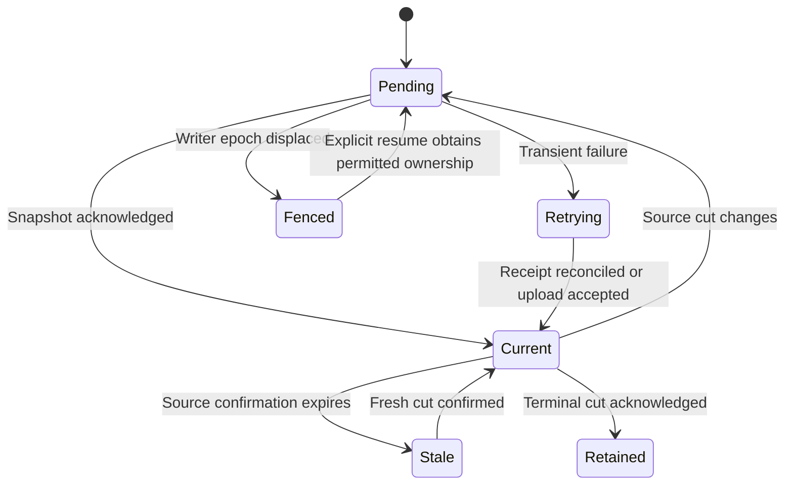

# Hosted Delivery Views - Plan

## Goal Capsule

- **Objective:** Let people follow a delivery from another device and revisit its progress when the delivery machine is offline.
- **Means:** A shared Cloudflare-hosted delivery viewer under v26technologies.com, with automatic publishing from enabled run-delivery repositories.
- **Product authority:** The user approved link-based viewing, support for any run-delivery repository, and the first-version scope below.
- **Execution profile:** One coordinated change request containing the service package, portable integration, tests, and documentation; service deployment and corpus release remain separate operational steps.
- **Authority:** The Product Contract governs behavior; AGENTS.md governs corpus changes and release qualification. Implementation authority is a separate handoff from this planning request.
- **Stop conditions:** Do not replace an existing DNS service or claim deployment without verified account/zone access; do not claim adopter proof from source-checkout tests.
- **Finish ownership:** The implementing lead carries U1–U6 through local verification and review; the authorized release/deployment operator completes U7 and records exact hosted and adopter evidence.
- **Open blockers:** None for local implementation; Cloudflare account/zone permissions and subdomain availability are deployment gates, not established facts.

---

## Product Contract

### Summary

Build a shared hosted viewer at deliveries.v26technologies.com that reuses the existing delivery views.
Enabled repositories publish progress automatically to stable, unlisted delivery links.
The hosted copy remains readable when its publishing machine is offline.

### Key Decisions

- **Link-based viewing.** Governs R2 and R3. Avoids requiring viewers to hold accounts. (session-settled: user-directed — chosen over approved-collaborator sign-in: anyone with the delivery link should be able to view.)
- **Reusable repository support.** Governs R4 and R5. Makes one service useful across the user's deliveries. (session-settled: user-directed — chosen over an agent-skills-only first version: support any repository using run-delivery.)
- **Hosted copies.** Governs R7 and R8. Keeps published progress accessible after the local process stops. (session-settled: user-approved — chosen over a local-machine-dependent viewing address: the published state must remain available offline.)

### Actors

- A1. The operator enables publishing for a repository and shares delivery links.
- A2. The local delivery workflow produces progress and publishes updates.
- A3. A viewer opens a shared link from any device without signing in.

### Requirements

**Viewing and access**

- R1. Serve the hosted viewer at deliveries.v26technologies.com on Cloudflare.
- R2. Give each published delivery a stable read-only link accessible without sign-in.
- R3. Keep delivery links unlisted, without a public repository directory or search-engine indexing; possession of a link permits viewing and forwarding it.
- R4. Support any repository using run-delivery through repository-level opt-in configuration.
- R5. Distinguish deliveries across repositories so one repository's updates cannot overwrite another's delivery.
- R6. Reuse the line map and its published plan, review summaries, and progress details, preserving existing unavailable and clipped-evidence indicators.

**Updates and availability**

- R7. Publish changes automatically while the delivery runs, including changes observed by the live watcher, without requiring repeated manual publishing.
- R8. Keep the last successfully published state readable when the publisher stops or its machine goes offline.
- R9. Show the last successful update time and indicate stale progress without representing lost contact as delivery completion or failure.
- R10. Retain completed delivery links for later viewing.
- R11. Report publishing failures locally and retry automatically without stopping delivery work or replacing the last valid hosted copy with an incomplete update.

**Publishing boundary**

- R12. Authenticate publishing and restrict each publisher to its authorized repository.
- R13. Upload only the intended delivery-view content, excluding credentials and local-only files.
- R14. Treat the hosted copy as a projection of the local delivery record, without accepting viewer commands that change delivery state.

### Key Flows

- F1. **Enable and share.** A1 enables publishing for a repository; A2 publishes a delivery and returns its stable link; A1 shares it with A3. Covers R1–R6 and R12–R14.
- F2. **Follow progress.** A2 observes delivery changes and publishes updates; A3's open page follows the latest successfully published version and displays its freshness. Covers R7 and R9.
- F3. **Lose contact and recover.** Publishing stops or fails; A3 can still read the last hosted copy while A1 sees the failure locally; after recovery, automatic publishing catches the hosted view up to current progress. Covers R8, R9 and R11.
- F4. **Revisit a delivery.** A3 opens the same link after completion and reads its retained progress. Covers R2 and R10.

### Acceptance Examples

- AE1. **Covers R1–R6.** Given two enabled repositories, when each publishes a delivery with the same local delivery name, then their links remain distinct and both are readable in a signed-out browser.
- AE2. **Covers R7 and R9.** Given an open hosted view, when a change reaches the local live watcher without a separate manual render command, then the hosted view updates automatically and shows the successful update time.
- AE3. **Covers R8 and R9.** Given a successfully published delivery, when its machine goes offline, then the same link keeps serving the last copy and eventually marks it stale without changing its recorded delivery outcome.
- AE4. **Covers R7, R8 and R11.** Given a rejected, interrupted, or timed-out upload, when delivery work continues, then the local failure is visible, the previous hosted copy remains intact, and recovery publishes current progress automatically.
- AE5. **Covers R5, R12 and R13.** Given a publishing credential for one repository, when it tries to replace another repository's delivery, then the service rejects it; published content contains no publishing credentials or unintended local files.
- AE6. **Covers R2, R3, R10 and R14.** Given a completed delivery, when a viewer reopens its shared link, then the retained view is available without sign-in, no public directory is offered, and the viewer cannot control the delivery.

### Scope Boundaries

- Delivery execution, local source-of-truth authority, and existing tracker publishing remain owned by run-delivery.
- Remote start, stop, retry, merge, and approval controls are outside this first version.
- Public repository browsing, viewer accounts, and a rebuilt delivery UI are deferred.
- Full raw artifact hosting beyond the existing rendered evidence is deferred.
- This plan does not authorize adding other execution hosts or repository-specific policy overlays.

### Dependencies / Assumptions

- Authorized Cloudflare account access and control of v26technologies.com must be verified before deploying or changing DNS; neither has been inspected in this work.
- The selected subdomain can be provisioned without replacing an existing service; planning must verify this assumption.
- Public view content is intentionally accessible to anyone who receives its link; unlisted links are not viewer authentication.
- Corpus and release changes must follow AGENTS.md, including catalog/profile/provenance updates when releasable skills change and candidate/adopter qualification for runtime changes.

### Outstanding Questions

The planning questions are resolved by KTD1–KTD8 below.
No product question blocks implementation.
Cloudflare account authorization and domain availability must be verified before U7; deployment remains incomplete until those gates and live proof pass.

### Sources / Research

- `skills/orchestrate-work/scripts/render_state.py:1349`: validates the document, attempts renderers, then invokes publishers; publisher failures are recorded independently of the command's renderer-derived exit status.
- `skills/orchestrate-work/scripts/render_state.py:1758`: the local live view removes publishers from its render configuration, so attaching a publisher alone does not satisfy R7.
- `skills/orchestrate-work/SKILL.md`, Views and publishing / Keeping the live view current: current workflow ownership and local-view behavior.
- `skills/delivery-views/SKILL.md`, The line map / The plan chapter: existing view content and bounded embedded evidence.
- `.agents/orchestration.json`, state: the current adopter config selects the line map as live home, also renders history, and declares a tracker publisher.
- [Cloudflare Workers static assets](https://developers.cloudflare.com/workers/static-assets/): current platform support for a hosted viewer; storage and update transport remain planning decisions.

---

## Planning Contract

**Product Contract preservation:** Behavioral scope and R/A/F/AE IDs unchanged; its planning questions are resolved here and its deployment prerequisites remain explicit.

### Problem Frame

The current line map is served by a loopback-only process, so its address and availability depend on the delivery machine.
The existing supervisor and live view have different lifetimes and different publishing behavior, making a generic upload hook insufficient for continuous hosted viewing.

### Key Technical Decisions

- KTD1. **Separate deployable package in this repository.** Add `hosted/delivery-viewer/` with its own Node manifest, lockfile, TypeScript configuration, Wrangler configuration, and CI lane. Keep root page-test dependencies and corpus archive contents independent. Governs U1–U3 and U6; advances R1 and R4. This implements the confirmed package boundary rather than creating another repository or execution host.
- KTD2. **Publish data into trusted views.** Define `hosted-delivery-snapshot/1` as a bounded JSON projection and reuse the fixed line-map/run-summary assets from `skills/delivery-views/assets/` at service build time. The service accepts no HTML, scripts, arbitrary assets, or executable renderer configuration. A static hosted shell loads the validated projection through a small store adapter. This preserves R6 while treating publishing repositories as data producers rather than code publishers on a shared origin.
- KTD3. **Immutable snapshots with transactional delivery metadata.** Use one SQLite-backed Durable Object per opaque public delivery ID and a private R2 bucket for immutable projection bodies. The DO owns repository binding, writer epoch, sequence, lease, accepted digest, snapshot pointer, and acknowledgement times. After awaited R2 storage succeeds, a synchronous metadata transaction rechecks epoch/sequence before advancing the pointer. No cross-product transaction is assumed. This implements R5, R8 and R11; R2 conditional pointers alone would still need the same writer-fencing protocol.
- KTD4. **Separate repository credentials and public capabilities.** Provision a random repository ID and a distinct high-entropy bearer publishing token per repository; store only token digests and repository scope in a Worker secret binding. Compare digests with a constant-time primitive, authenticate before any mutation, and never use a Cloudflare account-management token for publishing. Public IDs contain 256 random bits and authorize read-only viewing under `/d/<public-id>`; public handlers provide no listing. Per R2, R3 and R12, a forwarded link grants viewing, not publishing.
- KTD5. **Dedicated owned watcher.** Put collection/upload in `skills/delivery-views/scripts/hosted.py`, configured through an optional `hosted` member of `.agents/delivery-views.json`; do not add it to generic `state.publishers` or change local live's no-publisher rule. `run_delivery.py` starts/adopts it beside the separately surviving live view and manages its recorded lock/PID and generation. It continues through a supervisor restart and exits on record/generation disappearance. This closes R7 without replaying tracker writes.
- KTD6. **Freeze source before public projection.** Extract collection and pure payload construction from `render.py` without changing local output. Capture selected record/journal, plan, needs, and selected run/review inputs as a source cut, verify their identities/digests before and after collection, and publish only if the cut remained stable. A changed cut is discarded and coalesced into the next attempt. Never read previously rendered mutable HTML as the upload source. Carry the cut fingerprint with its candidate/evidence identity, per R6 and R11.
- KTD7. **Truthful freshness and bounded work.** Use a 2-second change debounce with a 10-second maximum deferral, one render/upload in flight, a 30-second source-check/confirmation interval, 5-second viewer polling, and stale after 120 seconds without successful source confirmation. Enforce a 60-second capture deadline and 30-second upload deadline; retry transient failures with jittered exponential backoff from 2 to 60 seconds. A connectivity heartbeat alone never refreshes source freshness. Closed views show their recorded outcome and final acknowledged revision rather than becoming misleadingly stale merely because publishing ended. Advances R7–R11.
- KTD8. **Persistent identity, fenced writers, and explicit status.** Store the public ID, canonical delivery key/repository binding, current writer epoch, sequence, pending digest, and last acknowledgement in credential-free sidecars beside the record; include identity/status in archives. An exclusive local lock prevents two owners. The service grants a 180-second writer lease, renews it on accepted source confirmations, and rejects expired or displaced epochs. Restart reconciles its persisted session; a competing owner cannot silently take over an active lease, and a fenced owner never reacquires through ordinary retry. Existing status/doctor/view commands expose the hosted URL, owner state, pending/current/failed publication, last receipt, and safe retry advice for operators and agents. Advances R2, R4, R5, R9–R12 and R14.

### Public Data and API Boundaries

The sole upload body is the U1 schema: public document fields consumed by the current delivery's line map, bounded run/review summaries, safe canonical links, view labels/lenses, optional plan/needs projection, source fingerprint, and protocol version.
Build an explicit nested allowlist from the actual asset consumers; omit local paths, command argv, environment maps, raw stdout/stderr, raw briefs/results, cache contents, full exports, history configuration, and unrelated delivery inventory.
Keep candidate identity, verdicts, dissent, unavailable state, clipping flags, and original event times intact when projecting.
Treat plan and summary prose as intentionally public content; reject known configured secret values and credential-shaped fields before upload, without claiming that a scanner can recognize every secret someone types into free text.
No recursive directory uploads or path-following of arbitrary record values are allowed; fixed source paths must remain inside their approved roots after symlink resolution.

The protocol exposes authenticated session acquisition/renewal, bounded snapshot commit, and authenticated receipt/status inspection, plus anonymous current-delivery metadata and snapshot reads.
All mutations check repository binding and current session; public handlers reveal only the selected delivery and generic not-found responses.
Unknown schema versions, unknown keys, malformed identifiers, unsupported content types, and projection bodies exceeding 16 MiB are rejected without replacing the current pointer.
Stream/count request bytes before parsing bounded JSON, including chunked bodies and missing or dishonest Content-Length headers.

A snapshot commit carries writer epoch, strictly increasing sequence, and projection digest.
An exact accepted retry returns the stored receipt, even if the original HTTP response was lost; reuse of a sequence with different bytes is a conflict.
Concurrent uploads may finish R2 writes in any order, but pointer commit checks after the await prevent an old epoch or sequence from regressing the view.
Public GET resolves only the committed pointer; staged objects never become reachable through public routes.
A small number of orphaned immutable objects from interrupted commits is acceptable in v1; a future cleanup must prove an object is unreferenced before deletion, and no bucket lifecycle rule may delete retained completed snapshots.

### Lifecycle and Close

The hosted watcher has the same generation-aware adoption rules as the local live view, with its own locked PID and status sidecar; no PID-pattern termination is permitted.
Watch canonical source changes plus plan, needs, and run/review inventory changes, and make a periodic full source check so evidence-only changes are observed.
Do not hold the shared delivery lock across run commands, rendering, or network I/O.
Credentials reach only the uploader process, not projection commands or unrelated children; status/errors contain bounded error codes rather than headers, payloads, raw service responses, or capability URLs in logs.

On delivery close, capture the terminal cut and leave it durably pending before local shutdown.
Attempt a final publication without adding more than 30 seconds to local close; if pending, the already-owned watcher retries for up to 10 minutes, then exits retaining an explicit final-publication-pending status.
A later normal resume or explicit hosted retry reconciles the receipt and catches up from the archived terminal cut using the same public identity.
No new credentials or uploader start are triggered by `view --archive`.
The remote page remains at its last accepted state and becomes stale if a final snapshot was never acknowledged; local completion is never reported as proof of remote completion.

### Hosted View Behavior

Keep the current line-map chapters and detail panels; add only a compact hosting-status strip with last source confirmation, publication time, and disconnected/stale state.
Serve a fixed trusted HTML shell and external versioned JS/CSS with escaped JSON data rather than inline publisher markup.
The store adapter follows the committed revision, preserves selection/scroll/fold state on updates, and leaves the current page readable on poll failure.
Strip history links and do not deploy history rendering as a public route.
Use `Cache-Control: no-store` for metadata/current pointers; immutable snapshots and build assets can be cached by digest with an explicit compatible schema/asset version.
Set no-referrer, noindex/nofollow/noarchive, nosniff, and restrictive CSP headers on all relevant routes; external links use noopener/noreferrer and only the existing approved URL templates.
Disable any default request logging that records public capability paths; use bounded internal correlation IDs, not URLs, tokens, or payloads.

### High-Level Technical Design

### Alternatives and Considered Non-Goals

A tunnel to the local server fails R8, so the service stores published projections.
Running every generic publisher from `live` would violate the existing no-publisher invariant and repeat tracker writes; KTD5 instead owns a hosted-only observer.
Accepting arbitrary active HTML would make each repository a script publisher on the shared origin; KTD2 reuses trusted assets with data-only uploads.
WebSockets, Access-managed viewer accounts, a hosted database of all repositories, automatic garbage collection, and remote delivery controls are not built in v1 because polling and per-delivery storage meet the agreed use without those mechanisms.
Reconsider transport only after measured polling or scale needs justify it; reconsider cleanup only with actual storage growth and a tested retention policy.

### System-Wide Impact and Research Basis

- The existing supervisor executes publishers before refreshed Needs you and HTML (`run_delivery.py`, `Supervisor.one_pass`); U4/U5 therefore use a fresh source cut rather than the last renderer file.
- `render_state.py` explicitly removes publishers from live renders and `tests/test_orchestration_render.py` pins that behavior; U5 preserves it.
- `views_common.py` has explicit config keys and child-environment scrubbing; U1/U4 extend validation and credential boundaries rather than relying on child scrubbing to sanitize content.
- `docs/solutions/design-patterns/runless-review-observations-2026-10-23.md` requires candidate-bound review evidence and non-regressing observations; U1/U2 preserve that in projection/ordering tests.
- `docs/solutions/test-failures/detached-fixture-supervisors-outlive-interrupted-workers-2026-11-09.md` and `docs/solutions/best-practices/stopping-a-recorded-pid-2026-11-03.md` govern U5 lifecycle and independent cleanup proofs.
- `docs/solutions/best-practices/profile-changes-reach-every-resolver-2026-11-03.md` governs U6 archive/resolver coverage.
- Official [DO SQLite storage](https://developers.cloudflare.com/durable-objects/api/sqlite-storage-api/) and [R2 consistency](https://developers.cloudflare.com/r2/reference/consistency/) support KTD3; the external I/O boundary still requires an application-level commit recheck.
- Official [Workers testing](https://developers.cloudflare.com/workers/testing/) and [Vitest integration](https://developers.cloudflare.com/workers/testing/vitest-integration/) govern the service test lane; select and lock current compatible Wrangler/Vitest integration versions rather than copying deprecated package/config examples.
- Official [Workers custom domains](https://developers.cloudflare.com/workers/configuration/routing/custom-domains/) governs U7; a conflicting existing DNS record is a stop condition, not permission to delete it.

### Deployment Prerequisites and Deferred Details

Read-only public DNS during planning returned Cloudflare nameservers and no A or CNAME answer for the selected subdomain; that is not account/zone authorization or proof that provisioning will succeed.
Before U7, verify active zone ownership, existing DNS/routes/Workers, service permissions, and an approved secret-provisioning path without printing credentials.
Local implementation and review can proceed with isolated DO/R2 bindings and fixture tokens; production deployment and live proof cannot be marked done until these prerequisites are satisfied.
Exact pinned dependency versions, helper names, and generated binding types are implementation details; pin compatible current packages, validate the installed Wrangler schema, and generate binding types from it.
Cloudflare resource IDs and the next admissible release version are execution-time values.

---

## Implementation Units

### U1. Define the public snapshot and reusable projection

**Goal:** Produce one explicit data-only public view contract without weakening local rendering.
**Requirements:** R3, R5, R6, R13, R14; F1/F2; AE1/AE5.
**Dependencies:** None.
**Files:** New `skills/delivery-views/references/hosted-snapshot.schema.json`, `skills/delivery-views/scripts/public_projection.py`, `tests/test_delivery_views_hosted_projection.py`, and shared fixtures under `tests/fixtures/delivery-views/hosted/`; modify `skills/delivery-views/scripts/render.py`.
**Approach:** Extract common bounded view-data construction, implement KTD2/KTD6's allowlisted projection, and publish versioned fixtures consumed by both Python and service validation. Keep existing local HTML construction and budgets authoritative.
**Patterns to follow:** `render_line_map`, `plan_block`, `within_budget`, `review_projection.py`, and existing JSON embedding/URL validation.
**Execution note:** Start with projection characterization and hostile-content fixtures before extracting collection logic.
**Test scenarios:**
1. Covers AE1. Current line-map plan, candidate identity, review verdicts and clipping/unavailable markers survive projection with equivalent meaning.
2. Covers AE5. Canary tokens, local paths, raw briefs/results, command argv, history links and unrelated delivery rows are absent; unknown fields are rejected.
3. Titles/findings containing markup or closing-script text remain inert data; unsafe URL forms never become links.
4. A source change during collection invalidates the cut instead of combining new state with old reviews or plan.
**Verification:** Python and service read the same valid/invalid fixture set; existing local render assertions remain unchanged. This seam proves projection, not Cloudflare/browser behavior.

### U2. Build scoped ingestion and persistent snapshot commits

**Goal:** Accept authenticated repository updates without snapshot regression or partial publication.
**Requirements:** R1, R5, R8, R11–R13; F1/F3; AE4/AE5.
**Dependencies:** U1.
**Files:** New `hosted/delivery-viewer/package.json`, `package-lock.json`, `tsconfig.json`, `wrangler.jsonc`, `src/worker.ts`, `src/delivery-object.ts`, `src/protocol.ts`, `test/ingestion.test.ts`, `test/ordering.test.ts`, and `test/fixtures/` references to U1 fixtures; all paths in this unit are under `hosted/delivery-viewer/` unless already qualified.
**Approach:** Implement KTD3/KTD4/KTD8, explicit session acquisition/resume, immutable repository binding, and atomic pointer advancement. Generate public IDs once under the local identity lock; the first authorized create binds the DO permanently to repository and canonical delivery identity. Carry a supported renderer contract version with each accepted snapshot. Expose no object-store credentials to publishers or viewers.
**Patterns to follow:** Official Worker bindings, SQLite DO transactions, private R2 bindings, strict current Wrangler schema and generated types.
**Test scenarios:**
1. Covers AE5. Wrong/missing credentials, encoded IDs and cross-repository writes fail before storage access and reveal no other delivery contents.
2. Pause old-epoch upload at R2 await, replace the permitted writer epoch, then release it; current pointer remains with the new writer.
3. Complete sequence N+1 before N and retry a lost acknowledgement; no regression or duplicate commit occurs, while same-sequence/different-digest is rejected.
4. Covers AE4. R2 failure and metadata-commit failure each preserve the previous valid snapshot; restart/eviction preserves sessions and receipts.
5. Malformed, chunked oversized, and unsupported-version bodies fail within bounds without exposing staged objects.
**Verification:** Tests execute against real local Worker/DO/R2 bindings, not only storage mocks; targeted injected failures cover both sides of the commit boundary. These tests do not prove production deployment.

### U3. Serve the trusted hosted line map

**Goal:** Show the reused delivery UI with truthful freshness and safe public reads.
**Requirements:** R1–R3, R6, R8–R10, R14; F2/F4; AE2/AE3/AE6.
**Dependencies:** U1, U2.
**Files:** New `hosted/delivery-viewer/src/viewer.ts`, `src/view-store.ts`, `src/viewer.css`, `scripts/build-assets.mjs`, `test/viewer.test.ts`, `test/browser/hosted-viewer.spec.ts`; modify `src/worker.ts` and package scripts within that package as needed.
**Approach:** Build fixed shell/assets from the existing corpus assets without copying a divergent renderer. Implement KTD7 polling with revision/schema checks and preserve local view state. Validate public route behavior and headers on shell, metadata, projection, errors and asset responses; root and unknown IDs offer no directory.
**Patterns to follow:** Existing line-map store subscription and text-based DOM construction; existing jsdom tests for behavioral assertions, with a real browser for security headers and navigation.
**Test scenarios:**
1. Covers AE2. A new acknowledged revision updates an already-open page without clearing selection, folds or scroll position.
2. Covers AE3. Poll failure and server-clock-driven expiry leave last progress readable and show stale status; a terminal acknowledged snapshot remains visibly completed.
3. Covers AE6. Shared URL works signed out and after publisher shutdown; no history/listing route or delivery-control action exists.
4. CSP/escaping prevent hostile projection text from executing; canonical external links leak no capability through Referer or opener.
5. An unavailable/incompatible projection keeps the prior view readable and shows an explicit compatibility/freshness failure rather than approval or empty evidence.
**Verification:** Real browser checks cover signed-out viewing, CSP, referrer, mobile layout and keyboard detail navigation; jsdom covers store/poll behavior but is not browser-security proof.

### U4. Implement the portable watcher and uploader

**Goal:** Automatically publish coherent changes and recover ambiguous acknowledgements.
**Requirements:** R4–R9, R11–R13; F1–F3; AE2–AE5.
**Dependencies:** U1, U2.
**Files:** New `skills/delivery-views/scripts/hosted.py`, `tests/test_delivery_views_hosted.py`; modify `skills/delivery-views/scripts/views_common.py`, `skills/delivery-views/SKILL.md`, and `.agents/delivery-views.json` documentation examples without enabling production secrets by default.
**Approach:** Add strict optional hosted config for trusted HTTPS service origin, repository ID and token environment-variable name. Require explicit destination configuration; never follow authenticated redirects. Implement KTD5–KTD8 and credential-free persisted identity/status; accept canonical delivery key from the owning run-delivery lifecycle. Expose start/status/retry/stop operations with JSON output and safe errors.
**Patterns to follow:** Existing bounded argv execution and config validation; frozen input projection from U1; current recorded-PID/lock patterns.
**Test scenarios:**
1. Covers AE2. State-only, plan-only, needs-only and review-artifact-only changes publish without manual render, and no tracker publisher is invoked.
2. Covers AE4. Lost HTTP response, restart, expired lease and fenced session reconcile safely; retry retains identity and does not refresh source freshness after collection failure.
3. Covers AE5. Credentials reach only upload transport, never render subprocesses, status, archive, payloads or error output; HTTPS-origin validation and redirect rejection prevent credential forwarding.
4. Busy continuous changes coalesce within KTD7 bounds; missing source/generation causes self-exit independent of test fixture cleanup.
5. Corrupt or mismatched identity sidecar refuses overwrite with a clear local error, preserving current remote content.
**Verification:** A local fixture receiver checks protocol, bounded retries and process behavior; it is explicitly not Cloudflare proof.

### U5. Integrate owned publishing into delivery lifecycle

**Goal:** Make hosted progress discoverable and reliable through ordinary start, resume and close.
**Requirements:** R2, R4, R7–R12, R14; F1/F3/F4; AE2–AE4/AE6.
**Dependencies:** U4.
**Files:** Modify `skills/run-delivery/scripts/run_delivery.py`, `skills/run-delivery/SKILL.md`, `skills/run-delivery/references/config.md`, `skills/run-delivery/references/adopting.md`, `tests/test_run_delivery_supervisor.py`, and `tests/test_own_deliveries.py`; add `tests/test_run_delivery_hosted.py`.
**Approach:** Start/adopt the separate hosted watcher using the existing live lifecycle rather than supervisor-pass publisher ordering. Resolve config from the delivery's binding shelf. Keep link/status visible after close, copy durable identity and pending terminal cut into archives, and integrate bounded close/final retry from the lifecycle contract. Preserve the generic live/no-publisher invariant.
**Patterns to follow:** Supervisor `start_live`, generation-aware listener adoption, locked recorded PIDs and close ordering; `render_views(only=...)` remains unchanged for tracker publishing.
**Test scenarios:**
1. Two starts/resumes for one delivery yield one owner and one public URL, while a supervisor stop leaves the hosted observer alive by design.
2. A generation transition safely replaces the prior owner; a recycled/unrelated PID is never signalled.
3. Covers AE4/AE6. Close with successful, delayed and unavailable uploads respects its 30-second additional bound; final receipt or pending state survives archive and later retry.
4. Viewing an archive requires no publishing token, starts no uploader and still exposes the known link/status.
5. Direct source mutations publish remotely without any tracker side effect, including when supervisor passes render publishers before views.
**Verification:** Lifecycle fixtures independently prove production self-exit and fixture cleanup; the existing no-publisher live regression remains intact.

### U6. Package, document and qualify the integration

**Goal:** Ship all reusable files in selected profiles and prove configuration-only adoption.
**Requirements:** R4, R6, R7, R12, R13; F1; AE1/AE5.
**Dependencies:** U1–U5.
**Files:** Modify `catalog.json`, `profiles/delivery-views.json`, `profiles/run-delivery.json`, `profiles/linear.json`, `profiles/jira.json`, `provenance.lock.json`, `docs/own-deliveries.md`, `tests/test_delivery_views_adopter.py`, `tests/test_registry.py`, `tests/test_release_integration.py`; add `docs/hosted-deliveries.md`, `.github/workflows/hosted-delivery-viewer.yml`, and `hosted/delivery-viewer/README.md`; inspect and update every resolver that selects the affected profiles.
**Approach:** Deliberately add new releasable outputs, update catalog/profile language in outcome terms, then refresh digests through the provenance writer. Keep hosted package files out of product archives and root page-test manifests unchanged. Add service type/build/Worker/browser tests to its own CI lane and include the lane in merge verification for service/shared-asset changes. Exercise installation from built archives in a clean adopter.
**Patterns to follow:** Existing adopter and release-integration tests, exact archive qualification, and AGENTS.md release metadata rules.
**Test scenarios:**
1. Covers AE1. Two clean adopters with different repository bindings use installed scripts through configuration alone and retain isolated hosted identities.
2. Built archive contains every reusable hosted integration output and excludes service package files, dependency stores, credentials and sidecar runtime state.
3. Covers AE5. Archived configuration/status and all hosted requests pass credential-canary checks.
4. Registry/provenance checks and all profile resolvers agree after new output-list changes; historical qualification files remain byte-for-byte unchanged.
**Verification:** Installed-archive proof is recorded separately from source tests and service CI; no fixture result is described as live proof.

### U7. Deploy and prove a real adopter delivery

**Goal:** Make the custom-domain viewer operational and prove its intended off-machine behavior.
**Requirements:** R1–R14; F1–F4; AE1–AE6.
**Dependencies:** U6; verified Cloudflare account/zone permissions and collision-free hostname.
**Files:** `hosted/delivery-viewer/wrangler.jsonc`, `hosted/delivery-viewer/README.md`, `docs/hosted-deliveries.md`, `.agents/delivery-views.json`, and the delivery's evidence/record location; installed generation changes occur only through the supported apply lifecycle, never source edits under `.agent-skills/`.
**Approach:** Provision private storage and scoped publishing secrets, deploy the reviewed service build, and attach the verified subdomain. Use the repository's candidate/adopter/final flow wherever runtime or record-shape changes require it; apply the exact verified archive in the adopter before claiming that its delivery uses the new publisher. Record service build SHA, asset digest, archive digest and active generation separately.
**Execution note:** Prefer a real smoke delivery and signed-out remote browser over more fixture-only coverage.
**Test scenarios:**
1. Covers AE1/AE2. Two configured repositories publish matching local delivery names, an unrelated signed-out device reads each link, and a live change appears within the configured healthy cadence.
2. Covers AE3. Disconnect the publisher and confirm retained remote content plus stale indication; reconnect and verify catch-up without a new URL.
3. Covers AE4. Interrupt an upload and restart the installed publisher; the hosted view never regresses and eventually acknowledges current progress.
4. Covers AE5/AE6. Wrong repository credentials are rejected, completed link survives shutdown, and no listing/history/control route or secret-bearing asset is public.
**Verification:** Preserve actual custom-domain HTTP/browser evidence, disconnect/reconnect results, exact deployed bytes and installed-archive identity; stop short of deployment completion if any prerequisite or live proof remains unavailable.

---

## Verification Contract

### Failure Cases and Review Ownership

| Failure boundary | Primary proof | Implementation review lenses |
| --- | --- | --- |
| Wrong repository writes or credential disclosure | U1/U2/U4 fixtures and Worker runtime tests | Security, API contract |
| Delayed session/sequence overwrites new progress | U2 controlled interleavings and eviction/retry tests | Correctness, adversarial, data integrity |
| Supervisor ordering or side-input changes produce stale snapshots | U1/U4/U5 integration tests | Correctness, reliability |
| Duplicate owners, leaked children or unrelated PID termination | U4/U5 process tests | Reliability, testing |
| Public UI loses evidence meaning or executes injected content | U1/U3 shared fixtures and real browser | Security, design, correctness |
| Source works but installed archives omit integration | U6 clean adopter and profile/resolver tests | Project standards, API contract |
| Local/CI evidence mistaken for live completion | U7 exact deployment/adopter receipt and remote browser | Delivery lead and evidence review |

Plan review must challenge the architecture, coherence, feasibility, scope, UI behavior and trust boundaries before implementation.
Implementation review examines the final candidate and its actual test evidence; plan approval is not implementation approval.
Collect related fixes before rerunning affected sensors and reviewers, and rerun only changed lenses plus coherence; no fixed round count can override an unresolved consequential finding.

### Repository and Service Sensors

| Check | Command or evidence | Applies |
| --- | --- | --- |
| Private test environment | `python3 scripts/bootstrap-test-environment.py` | Before corpus sensors in each worktree |
| Registry | `.venv/bin/python scripts/validate-registry.py` | Catalog/profile/config or corpus output changes |
| Provenance | `.venv/bin/python scripts/update-provenance.py --check` | After deliberate output-list edits and writer refresh |
| Focused Python coverage | Relevant U1/U4/U5/U6 test modules, including orchestration render and adopter/release integration | While implementing affected units |
| Full repository suite | `.venv/bin/python scripts/run-tests.py` | Final candidate; macOS Python 3.11 before any release tag |
| Worker type/build/runtime/browser lane | Package-local locked scripts `typecheck`, `build`, `test`, `test:browser` defined by U2/U3/U6 | Service and shared asset changes |
| Hosted CI | Exact candidate's Ubuntu and cut-release gate plus new service lane | Report not-started, absent or failed checks explicitly |
| Installed adopter | Exact candidate/final archive verification and apply receipt | Release-dependent delivery integration |
| Live proof | Custom-domain HTTPS, exact service/asset build, signed-out off-machine device, disconnect/reconnect | U7 only |

Commands above are verification entry points, not evidence that any checks ran during planning.
Use current official Workers testing tools and real local bindings; lock dependencies and retain reproducibility.
Do not broaden a passing check without a new change or unresolved concern.

---

## Definition of Done

- U1–U6 are implemented with their owned tests, shared fixtures and unchanged local-render/no-tracker-replay behavior; abandoned implementation experiments are removed.
- The final implementation candidate has risk-relevant review with no unresolved consequential findings and passing applicable local and hosted checks, or an explicitly reported evidence gap that prevents a completion claim.
- Releasable outputs, selected profiles, catalog metadata and writer-generated provenance agree; historical records are preserved.
- U7 prerequisites and live scenarios pass with recorded deployed service/asset bytes and an applied verified adopter generation; source-only, fixture-only or CI-only evidence cannot substitute.
- A viewer can open the same delivery link from another device, follow current progress, read the last accepted copy while the publisher is offline, and revisit acknowledged completed progress.
- The handoff distinguishes plan review, implementation review, local checks, hosted CI, release qualification, adopter application, deployment and live verification by their actual states.

---

## Delivery Decisions

- Track the outcome under the existing parent V26-3070 in the yaegars team's agent delivery harness project; keep its original description and seven child outcomes.
- Deliver from the verified installed linear-v2.3.0 generation on `integrate/hosted-deliveries`, targeting `main`. The published product source remains `skills/`.
- Use two independent lane sessions, with subagents only for each lane's review lenses; lanes never integrate or release.
- The corpus lane updates mandatory catalog/profile/output-list metadata in each releasable change so every candidate validates; the queue regenerates digests. The lead owns cross-lane integration and the check catalogue. This refines the earlier metadata-batching guidance to satisfy AGENTS.md.
- The lead runs a macOS Python 3.11 full-suite budget check on the final integration even though the base's focused posture skips supervisor fullHealth. No skipped check is a pass.
- Use the installed plan-review and delivery-review evidence contracts; prior CE planning review remains context, not substitute evidence. Plan review is unbounded; lane delivery review uses its declared bound and risk-relevant lenses.
- Keep final service deploy, candidate/final release, installed adoption and off-machine proof as explicit finish lines. Do not close the parent after code-only integration.

## Units and order

| Tier | Lane | Owns | Work |
| --- | --- | --- | --- |
| 1 | 1 | `.github/workflows/hosted-delivery-viewer.yml`, `catalog.json`, `docs/hosted-deliveries.md`, `docs/own-deliveries.md`, `profiles/delivery-views.json`, `profiles/jira.json`, `profiles/linear.json`, `profiles/run-delivery.json`, `provenance.lock.json`, `skills/delivery-views/SKILL.md`, `skills/delivery-views/references/hosted-snapshot.schema.json`, `skills/delivery-views/scripts/hosted.py`, `skills/delivery-views/scripts/public_projection.py`, `skills/delivery-views/scripts/render.py`, `skills/delivery-views/scripts/views_common.py`, `skills/run-delivery/SKILL.md`, `skills/run-delivery/references/adopting.md`, `skills/run-delivery/references/config.md`, `skills/run-delivery/scripts/run_delivery.py`, `tests/fixtures/delivery-views/hosted/`, `tests/test_delivery_views_adopter.py`, `tests/test_delivery_views_hosted.py`, `tests/test_delivery_views_hosted_projection.py`, `tests/test_own_deliveries.py`, `tests/test_registry.py`, `tests/test_release_integration.py`, `tests/test_run_delivery_hosted.py`, `tests/test_run_delivery_supervisor.py` | Public projection, uploader, lifecycle, qualification |
| 2 | 2 | `hosted/delivery-viewer/` | Ingestion, viewer, deploy proof |

## Stories

### V26-3514. Define the public snapshot and reusable projection

Lane 1, tier 1, not blocked. Implements U1 above, including its complete Requirements, Approach, Test scenarios and Verification. Files: `skills/delivery-views/references/hosted-snapshot.schema.json`, `skills/delivery-views/scripts/public_projection.py`, `skills/delivery-views/scripts/render.py`, `tests/test_delivery_views_hosted_projection.py`, `tests/fixtures/delivery-views/hosted/`, `catalog.json`, `profiles/delivery-views.json`, `profiles/run-delivery.json`, `profiles/linear.json`, `profiles/jira.json`, `provenance.lock.json`.

### V26-3515. Build scoped ingestion and persistent snapshot commits

Lane 2, tier 2, after V26-3514. Implements U2 above, including its complete Requirements, Approach, Test scenarios and Verification. Files: `hosted/delivery-viewer/`.

### V26-3516. Serve the trusted hosted line map

Lane 2, tier 3, after V26-3514, V26-3515. Implements U3 above, including its complete Requirements, Approach, Test scenarios and Verification. Files: `hosted/delivery-viewer/`.

### V26-3517. Implement the portable watcher and uploader

Lane 1, tier 3, after V26-3514, V26-3515. Implements U4 above, including its complete Requirements, Approach, Test scenarios and Verification. Files: `skills/delivery-views/scripts/hosted.py`, `skills/delivery-views/scripts/views_common.py`, `skills/delivery-views/SKILL.md`, `tests/test_delivery_views_hosted.py`, `catalog.json`, `profiles/delivery-views.json`, `profiles/run-delivery.json`, `profiles/linear.json`, `profiles/jira.json`, `provenance.lock.json`.

### V26-3518. Integrate owned publishing into delivery lifecycle

Lane 1, tier 4, after V26-3517. Implements U5 above, including its complete Requirements, Approach, Test scenarios and Verification. Files: `skills/run-delivery/scripts/run_delivery.py`, `skills/run-delivery/SKILL.md`, `skills/run-delivery/references/config.md`, `skills/run-delivery/references/adopting.md`, `tests/test_run_delivery_supervisor.py`, `tests/test_run_delivery_hosted.py`, `tests/test_own_deliveries.py`, `catalog.json`, `profiles/delivery-views.json`, `profiles/run-delivery.json`, `profiles/linear.json`, `profiles/jira.json`, `provenance.lock.json`.

### V26-3519. Package, document and qualify the integration

Lane 1, tier 5, after V26-3514, V26-3515, V26-3516, V26-3517, V26-3518. Implements U6 above, including its complete Requirements, Approach, Test scenarios and Verification. Files: `catalog.json`, `profiles/delivery-views.json`, `profiles/run-delivery.json`, `profiles/linear.json`, `profiles/jira.json`, `provenance.lock.json`, `docs/own-deliveries.md`, `docs/hosted-deliveries.md`, `tests/test_delivery_views_adopter.py`, `tests/test_registry.py`, `tests/test_release_integration.py`, `.github/workflows/hosted-delivery-viewer.yml`, `hosted/delivery-viewer/README.md`.

### V26-3520. Deploy and prove a real adopter delivery

Lane 2, tier 6, after V26-3519. Implements U7 above, including its complete Requirements, Approach, Test scenarios and Verification. Files: `hosted/delivery-viewer/wrangler.jsonc`, `hosted/delivery-viewer/README.md`, `docs/hosted-deliveries.md`.

## Delivery Finish Line

- Both installed plan-review lenses align at the exact committed candidate.
- Every story meets its criteria and is merged or explicitly settled through the repository workflow.
- Final local Python 3.11 suite stays inside `tests/suite-budget.json`; service type/build/runtime/browser sensors pass.
- Reviewed integration reaches main and exact main-push Ubuntu, cut-release and service CI are verified.
- Exact released integration is applied in an adopter, and the reviewed Cloudflare build serves the chosen custom domain with off-machine and offline/catch-up proof.

## Delivery Approvals

- Kwamina approved the product scope and implementation direction and asked to track in Linear then deliver through repository workflows.

## Delivery Out of Scope

- Remote delivery controls, public repository directory, viewer accounts, raw artifact hosting and alternate execution hosts.
